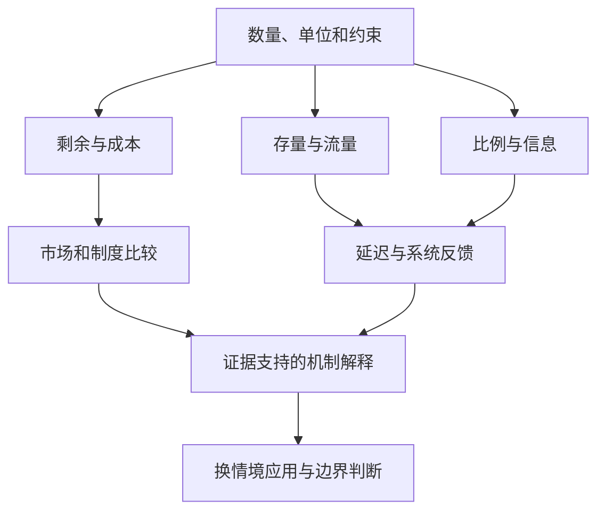

# EcoSimEdu 下一轮学习能力升级设计

适用基线：`bfe31dd945eaff3cac7c92a580974ad1e3cd45e2`。本文件是待实施规格。保留现有 12 课、七阶段框架、领域视图、离线模型、事件证据和既有手算组件。目标是使它们共同支持连续自主学习，而非把课程做得更长或更多。

## 1. 学生真正获得的四项能力

学生完成一课后，应当能回答四个问题：

1. **我能解释什么？** 用熟悉的经济主体和明确的变量描述问题。
2. **我能独立做什么？** 算出一个量、分类一条记录、追踪一条机制，或设计一个有效对照。
3. **我凭什么这样判断？** 指向实际事件、规则与条件，区分账本关系、模型干预和历史事实。
4. **下次遇到不同情境怎么办？** 找到相同机制与失效的前提，并知道何时需要补充证据。

产品界面用“已练习”“能独立完成此类任务”“待再练一次”等可理解表述。不要把打开页面、跑完模型、保存笔记直接变成“掌握 93%”；也不要因为某题未答对而阻止学生探索后续内容。

## 2. 课程结构：保留四个主题，建立跨课能力连接

### 2.1 概念和能力分开建模

概念回答“学什么”，能力回答“会如何使用”。同一个概念可在多个案例出现；同一案例可练计算、解释和比较，不能只用案例 ID 代表能力。

下列 18 个概念是本次归并草案，ED01 应根据课程目标进一步合并或拆分；概念数量不作为验收指标。初版稳定要求是 12 课各 3 个可观察目标，共 36 条目标—活动—证据映射，可以共享概念。

| 稳定 ID（拟议） | 概念单元 | 首次建立/再次应用 |
|---|---|---|
| C01 | 资源、约束与机会成本 | 拍卖、公共物品、GME |
| C02 | 边际量、交易剩余与配置效率 | 拍卖、柠檬、碳市场 |
| C03 | 账户转移与实际资源成本 | 拍卖→公共物品/公地→碳市场 |
| C04 | 存量、流量与账户平衡 | SVB→啤酒游戏/公地 |
| C05 | 流动性与偿付能力 | SVB；与闪电崩盘的“市场流动性”辨异 |
| C06 | 局部比例与总体统计 | Schelling→信息级联/GME 的汇总口径 |
| C07 | 阈值、反馈与涌现 | Schelling→SVB/闪电崩盘 |
| C08 | 信号、相关信息与信念更新 | 信息级联→SVB/GME |
| C09 | 私人激励与集体收益 | 公共物品→公地 |
| C10 | 共同池资源与再生 | 公地治理 |
| C11 | 信息不对称与参与选择 | 柠檬市场 |
| C12 | 偏好、优先序与稳定匹配 | 学校匹配 |
| C13 | 延迟、库存位置与动态反馈 | 啤酒游戏 |
| C14 | 订单簿深度、成交与市场流动性 | 拍卖→闪电崩盘/GME |
| C15 | 排放约束、许可分配与成本效率 | 碳市场 |
| C16 | 处理变量、控制条件与反事实 | 所有案例；由具体预设上升到学生设计 |
| C17 | 证据、机制解释与因果边界 | 所有案例 |
| C18 | 模型条件、路径差异与不确定性 | 所有案例 |

能力维度采用六类，不直接合成为单一分数：`identify` 识别变量/口径；`calculate` 计算与对账；`trace` 追踪微观到总体的关系；`design` 设计比较；`explain` 用证据解释；`transfer` 换情境应用并识别边界。

这张图用于设计顺序，不是把六门前置课设为硬锁。强先修边应保持无环，跨课类比和辨异另用关联边。路径页默认展示“你要解决的问题—三个学习单元—最后能完成的任务”；完整概念图放在展开层。

### 2.2 五个可跳过的数学和推理桥梁

| 桥梁 | 2–4 分钟任务 | 首次触发 | 可跳过的依据 |
|---|---|---|---|
| 比例与分母 | 点出分母对象，算 2/6，与 30% 比较 | Schelling | 一个新邻域独立判断成功 |
| 存量与流量 | 将“余额、申请、实付”放入正确时间格 | SVB | 一组到账前后账表独立核对 |
| 边际与总量 | 从两档增加量累加总成本 | 拍卖/碳市场 | 新数值边际题正确并说明单位 |
| 条件概率 | 以自然频数呈现两箱和一次信号，再转为赔率 | 信息级联 | 能区分状态概率与信号准确率 |
| 对照与推断 | 在两组设置中找处理变量和共同条件 | 首次 compare | 能辨认混合改变多个参数的比较 |

微课的目标不是教授一套数学课，而是让当前经济学任务可理解。每个桥梁共享“看一个例子→补一步→自己试→回到案例”的界面。数学符号旁保留单位与一句语义解释。

## 3. 学习过程：七阶段框架内加深，不重造流程

| 现有阶段 | 增量学习动作 | 保存的证据 | 用户可选项 |
|---|---|---|---|
| 导入 | 看到三项成果；做 1–2 个前置诊断 | 诊断答案与所需桥梁 | 直接探索、跳过已会的部分 |
| 预测 | 除方向外选择理由、观察指标、信心 | 运行前锁定预测，不覆写原判断 | 允许不确定；不把预测错误等同无能力 |
| 行动 | 明确本次控制哪项行动和哪些主体由模型决定 | 行动、约束、运行版本 | 保留现有角色动作 |
| 观察 | 先给短提示，再自己找一个同类事件 | 独立选中的事件、单位与时间 | 查示例、请求提示、复盘 |
| 解释 | 完整例题→部分空缺→新变式；搭建机制链 | 尝试、错误类型、提示/解答曝光 | 继续探索不强制满分 |
| 对照 | 写一张实验计划卡；检验而非追求预定结果 | 假设、处理变量、控制、结果与修订 | 同结果/缺事件也是有效发现 |
| 笔记 | 论断—证据—推理—条件；近迁移和边界题 | 自评、参考例比较、换题表现 | 导出、下一课、稍后复习 |

“看更多事件”不是默认学习动作。每阶段给一个具体问题和一个最有帮助的主视图，其他表格、理论推导和参数按需打开。每个案例最终形成可读的一页学习成果：原判断、关键事件、机制解释、修订与下一步。

## 4. 教学蓝图与统一工程契约的映射

本节不定义第二套生产 Schema。所有代码、内容包和提示词使用 `education-contracts.md` 的十对象标准，以该附件为唯一工程契约。下列“学习单元”是内容作者安排目标、示例、练习和迁移的蓝图，落实时分别写入 `LearningOutcome`、`LessonActivity` 与 `AssessmentItem`，不增加一个平行运行时。

### 4.1 十对象怎样服务教学

| 统一对象 | 本教学设计的具体映射 |
|---|---|
| `ConceptDefinition` | 本文 C01–C18 的概念归并草案、定义、先修和误解；实际 ID 在 ED01 固化 |
| `LearningOutcome` | 每课三个可观察目标；计算、追踪、解释/比较/迁移是其具体表现，不重复增加泛化目标 |
| `AssessmentItem` | 诊断、部分填空、新变式、迁移；使用规范的 `id/version/variant_id/family_id/kind/evaluator`，判定由注册评估器完成 |
| `LearningAttempt` | 既有三旗舰表单和通用题目每次提交；完整保存题版本、展示顺序、暴露、结果及实际来源 |
| `LearnerEvidence` | 以规范规则从尝试派生；展示支持记录，不生成心理测量掌握概率 |
| `LessonActivity` | 在七个既有 phase 内插入示例、补一步、独立题或一层补救活动，并声明返回点 |
| `ExperimentCard` | 本文六字段学生任务映射到问题、假设、处理计划、控制、指标、证伪和实际运行对照等规范字段 |
| `ExplanationCard` | 论断—证据—机制步骤—条件；另外保留替代解释与分层反馈 |
| `ReviewSchedule` | 本地到期日与依据；到期是计划状态，不删除过去证据 |
| `Recommendation` | 当前目标、误解、复习和跨课联系生成有理由的下一步，可忽略 |

示例作者蓝图：单元 `svb.cash-vs-equity` 对应账表目标；完整例题 → 支持步骤填空 → 新数值独立题 → 银行A/B情境辨异 → 延后再提取。独立题输入现金12、证券28、贷款40、存款65、支持借款5，参考权益10。它是 `authored_model_exercise` 性质的教学小题，不是假装来自刚才运行的一帧。具体 `AssessmentItem` 按工程附件示例补齐 `context/response_schema/evaluator/feedback`，不使用本文另造字段。

### 4.2 任务类型及评价边界

首批遵循工程附件：单选、数值、机制排序、结构化解释。事件选择先复用现有引用控件并纳入解释卡，无须立即做一个额外通用题型。只有真实需要时才扩展类型；不先做任意题编辑器。

数值判定使用已注册的纯函数或明确声明的评估器，不执行内容包提供的任意脚本。真实运行题复用现有 SourceRef 解析对应字段、单位与时点，再复算。选择题响应保存稳定选项 ID；展示顺序另存，打乱位置不算新变式。开放解释只作结构完整性、事实与参考要点反馈，不假装确定性语义评分。

### 4.3 学习证据、辅助与旧记录

主状态统一为 `not_attempted / practicing / independent_evidence`，对外为“未尝试 / 练习中 / 有独立应用证据”。迁移按 `transfer_status` 单独呈现，复习到期由 `ReviewSchedule` 表示。一次独立成功只支持该目标的实际任务表现，不意味着永久掌握。证据要求在目标中明示，可包括新的变式和适用边界判断，不另设黑箱概率。

提示、示范答案和前次反馈的暴露按工程附件在显示前保存。新变式首次提交且没有本题辅助暴露，可成为独立证据候选；同变式看过反馈再答对属于重复/辅助修正。此前学过相关概念本身不算作弊或辅助。预测碰巧正确不提升概念证据；需要后续机制或条件任务。

拍卖表单、Schelling Practice 和 SVB Ledger 保留 UI 与领域校验，改为输出统一 `LearningAttempt`。已有 `first/latest/original` 继续可读，兼容迁移不能由旧反馈字符串推断历史独立成功。旧记录缺少暴露历史，保留为 legacy 且 `exposure_unknown=true`。`LearnerEvidence` 是可重建缓存，不能覆盖原始尝试或旧预测。

### 4.4 离线解释检查的能力边界

离线系统能可靠检查：引用是否存在且版本一致；所选事件是否在已揭示窗口；一项数值是否对账；对照是否保持声明的参数；解释是否填写了论断和条件。不能可靠用几个关键词判定一段开放因果解释正确。

开放解释提供锚点 rubric、范例对比与自评。可选 LLM 助教先提一个促进解释的追问，再指出证据与推理缺口，保留“建议”身份；不得覆盖确定性数值检查，不得生成未记录的主体动机。基础模式具备全部学习完成能力。

## 5. 三个旗舰深化单元

以下数值题是可核算的独立教学小题，均非历史观测。真实运行练习继续从 run 绑定字段取数。可选完整学习预计 25–35 分钟，属于待实测的设计预算；快速探索保留原路径。

### 5.1 双向拍卖：为什么成交更高价，不一定创造更多剩余？

**复用**：`AuctionExplain` 的成交结算输入、边际配对；现有角色 B01、订单→成交定位、需求与费用对照、证据笔记。新做的是支架层级、尝试记录和迁移，不替换订单簿。

**信息可见性**：下列完整算式中的双方价值与成本来自独立编写的教学小题，界面明确标“教学练习，非当前运行”。学生在当前运行的导入、预测和报价阶段只能看到本角色被授权的信息，不得因加入例题而暴露实际对手私人成本或全市场私人价值。真实运行的双方结算/完整供需仍遵守现有收盘或明确复盘权限；进入桥梁、补救或复习不能自动扩大 `reveal` 窗口。

**三个正式目标**：AUC-1，计算买卖双方与平台收益并对账；AUC-2，从实际订单/成交与边际配对解释配置结果；AUC-3，在制度对照和新情境中区分支付转移、资源成本与条件。下述各项是这三个目标的具体表现，迁移题不再另造第四个总目标。

**A. 前置诊断（约 2 分钟）**

- 买家现金 500、私人价值 108，最高愿付是否就是 500？正确：预算给出支付能力，私人价值与其他条件约束愿付；不能将现金全当商品价值。
- 成交价提高 5，买卖双方总剩余一定提高 5 吗？给定价值、成本和交易数量不变，正确为总剩余不变；价格重新分配双方收益。
- 错误者进入 2 分钟“价值、价格、成本”桥梁；成功者直接行动，不需完整重做。

**B. 完整例题（约 3 分钟）**

一件商品，买方价值 110、卖方成本 80、成交价 96，每方付平台费 4，平台不发生本题之外的资源消耗。

| 计算对象 | 算式 | 答案 |
|---|---|---:|
| 买方剩余 | 110−96−4 | 10 |
| 卖方剩余 | 96−80−4 | 12 |
| 平台收入 | 4+4 | 8 |
| 三方合计 | 10+12+8=110−80 | 30 |

先让学生指出 96 在谁的账里增加/减少，再展开完整算式。自解释问题：“为什么汇总后价格抵消？哪项题目条件让平台收入可以直接合入总剩余？”参考：相同支付一出一入；这里平台没有另计资源成本。

**C. 部分填空（约 2 分钟）**

价值 108、成本 84、价格 96、每方费 2。显示买方 `108−96−2=10`，让学生补卖方与平台：10、4，总计 24。误填卖方 12：提示“卖家还承担哪一笔支出？”误填平台 2：提示“本题几方付费？”第二提示给 `2+2`，完整答案由用户主动展开。

**D. 独立变式（约 3 分钟）**

价值 103、成本 82、价格 94、每方费 3。隐藏例题答案，要求算三方收益并写总剩余。正确为 6、9、6、21。若只答总数 21 而分配错，标“总量计算正确，分配仍需核对”，不把三项合并成一个模糊错误。

再问：同一交易价格改为 97，其他不变，新的三方收益为 3、12、6，合计仍 21。该变式检验支付转移，避免机械照填。

**E. 回到真实实验（约 7 分钟）**

选择实际成交，使用现有表单独立核对；若 B01 未成交，允许选另一笔并解释 B01 未成交，不编造结果。随后在“费用”对照前填写：处理变量为每方交易费；共同条件为初态、种子与学生开局报价；观察指标为交易数量、三方剩余、未实现边际机会。若两组交易数相同，比较分配；若数目不同，从实际缺失的可行交易追踪，不能仅凭“费↑”预填福利下降。

**F. 解释 rubric（0/1/2 为本任务锚点，不作为人格或总体能力评分）**

| 维度 | 0：未提供 | 1：部分到位 | 2：可复核 |
|---|---|---|---|
| 论断 | 只有“好/坏” | 指出价格/成交变化 | 明确对象、指标和对照条件 |
| 证据 | 没有实际记录 | 引用但未说明作用 | 一笔交易/未成交与一个对照点支持论断 |
| 推理 | 将支付全算资源损失 | 会算但未连接规则 | 说明价值成本、支付抵消和交易机会变化 |
| 条件 | 外推到所有市场 | 泛称“模型简化” | 指出费的去向、行为策略或资源成本条件 |

示范好答案应随真实事件生成字段，不写固定“成交减少”。参考骨架：“同样初态下，费用改变了____。事件____显示____，由报价与结算规则____可解释。这条结果支持本规则下____；平台成本或报价策略改变后须重新检验。”

**G. 近迁移与远迁移**

- 近迁移：价值 96、成本 92，双方各费 3；若买卖双方都坚持非负剩余，可接受价格区间存在吗？买方要求 `p≤93`，卖方要求 `p≥95`，无重叠。无费用时 `[92,96]` 可交易。该小题显式加入非负剩余行为条件，不强行解释所有现有代理策略。
- 远迁移：二手教材平台收取 6 元费用，其中 2 元支付新增验货耗材、4 元为平台净收入。和模型的“纯转移费用”有何不同？在价值与成本界定不含验货耗材的前提下，2 元是真实资源耗用；4 元为账户分配。不能把全部 6 元都当社会损失，也不能全部当无成本转移。

**H. 复习（单次 2–3 分钟）**

下一次返回时给新数值算式，稍后再给“涨价是否创造剩余”的一句解释。推荐碳市场：“把支付转移与资源成本用于配额交易”；或柠檬市场：“当实际质量变化，低价还是否代表高剩余？”

### 5.2 SVB：银行有正权益，为什么工资仍可能不到账？

**复用**：`SvbPanel` 的资产负债分类与 `Ledger` 权益输入，申请→部分付款→待付链、正权益待付定位、消息来源边、现金缓冲/网络对照。新做支架、账表变式和流动性概念迁移。

**三个正式目标**：SVB-1，用账表和申请记录区分申请/实付、现金/权益及各类变化；SVB-2，以实际消息、规则、申请与支付证据解释传导；SVB-3，设计或解释资产组合/网络对照并判断迁移条件。历史与教学数据身份是三个目标共同遵守的质量条件。

**A. 诊断**

- 银行借入 5，现金增加 5，权益是否增加 5？正确：借款负债同增，权益当时不变。
- 申请提款 18 但只收到 8，银行存款负债是否已经减少 18？正确：按本课规则只因实付减少 8，10 仍待付。
- 错误时先做两侧账户拖放/键盘分类，保留原 `classification` 组件；不立即堆叠整张账表。

**B. 完整例题：沿用模型说明的可手算结构**

初始：现金 10；证券 2 单位，每单位现值 9；贷款 22；存款负债 40；支持借款 0。先算权益 `10+18+22−40=10`。

| 依次发生 | 现金 | 证券市值 | 贷款 | 存款 | 支持借款 | 权益 |
|---|---:|---:|---:|---:|---:|---:|
| 初始 | 10 | 18 | 22 | 40 | 0 | 10 |
| 借入 5 | 15 | 18 | 22 | 40 | 5 | 10 |
| 卖一单位证券，收到 6 | 21 | 9 | 22 | 40 | 5 | 7 |
| 实付提款 12 | 9 | 9 | 22 | 28 | 5 | 7 |

解释：借款带来同额资产负债；急售相对当前市值损失 3；实付使现金与存款同减。不把证券重估与实际出售混为一笔。表格显示每一步变化，再显示不变项，支持键盘操作。

**C. 部分填空**

新账表：现金20、证券市值30、贷款50、存款80、借款0，权益20。依次：借入10；出售账面10的证券收到8；实付25。

- 借入后现金30、借款10、权益____ → 20。
- 卖出后现金38、证券20、权益____ → 18。
- 付款后现金____、存款____、权益____ → 13、55、18。

误把借入记为利润：先显示借款到期要还的一侧；误认为付款损益：让学生同时圈出现金和存款两项，第二提示再给算式。

**D. 独立变式**

新账表：现金12、证券28、贷款40、存款65、支持借款5。权益为10。当前唯一新申请18，实际支付8，没有其他待付：新现金4、新存款57、待付10、权益仍10。要求解释为什么“有10权益”和“尚待付10”可以同时成立。正确理由：权益包括不能立即拿来付款的资产，待付表示未兑付请求；两者恰好相等不构成恒等规律。

后续单独追加一步：借入12后现金16、支持借款17，权益仍10。不能把“融资成功”直接推成“银行已经没有风险”。

**E. 实验任务**

先用现有实际运行定位 D01 申请与实付，不要求每个种子都出现同一事件。再找正权益和待付共存的结算帧；若未发生，记录缺事件并按真实账表解释。实验计划分两次：改变初始现金组合；改变每人观察对象。注意现有现金缓冲组同时减少证券敞口，因此应表述为“初始资产组合的总效应”，不能说纯粹现金作用已经与重估暴露完全分离。

信息解释要求学生指出：一条消息来源、接收者当时知道的内容、模型中的风险规则、申请后银行的支付约束。时间上接续不等于后面所有提款都由 D01 造成。

**F. 解释 rubric**

| 维度 | 达到本任务的标准 |
|---|---|
| 账表 | 用实际一帧算出权益，现金/证券/贷款与两种负债口径齐全 |
| 支付 | 用同一 request_id 分开申请、累计实付、剩余，不重复扣存款 |
| 机制 | 把一条可见信息与实际规则连接，再接到请求和现金约束；承认工资等其他原因 |
| 对照/边界 | 指明处理变量与资产组合影响；只解释本模型，不填入历史 SVB 财报 |

给两段相近的解释让学生比较：“借入资金使银行更富有，因此不会挤兑”与“借款增加当期现金，同时增加负债；能否付清仍由现金、申请规模和支持上限决定”。让学生改写前者，而不是只选对后者。

**G. 近迁移与远迁移**

- 近迁移：银行 A 现金0、其他资产120、负债100；银行 B 现金30、其他资产50、负债100。仅依本题资产估值和支付规则，谁权益为正、谁能即时支付10？A权益20但无可用现金；B权益−20但现金足够支付该笔。正确结论区分两个维度，不把能付一笔当总体偿付安全。
- 远迁移：企业有下月到期应收款、本周工资与有限现金。相似机制是现金流时间错配；差异包括银行存款契约、存款保险、监管和支持工具，不能直接用储户挤兑的机制取代客户/供应商契约分析。问题要求列一项相似和两项需重建的前提。

**H. 复习与跨课**

延后小题先不显示公式：借款、重估、实付分别改变哪些量？然后在啤酒游戏分辨“订单”和“到货”；去闪电崩盘比较“银行可用现金不足”与“市场订单深度不足”。二者都涉及流动性，但含义和观测指标不同。

### 5.3 Schelling：每个人能接受少量同组邻居，整体为什么仍会分化？

**复用**：九格点选练习、30/50% 阈值判断、A001 开局动作、受影响邻居前后比、满意率/同类邻接率、三阈值同初态对照。重点是把既有局部计算组织为“局部规则—邻居外部影响—总体指标—路径条件”。

**三个正式目标**：SCH-1，选对分母并计算邻居变化前后的阈值状态；SCH-2，用真实迁居链连接局部影响和总体指标；SCH-3，通过同条件对照、终止原因及新情境判断适用边界，避免从图案反推真实动机。

**A. 诊断**

原九格中央 A；周围 2A、4B、2空位。分母6而非8或9；中央不计。按至少30%同组，`2/6≈33.3%` 满意；至少50%则未达标。继续复用现有点击分母的针对性反馈，并持久化到统一 attempt。

**B. 完整例题**

让一名 B 邻居迁出。中央不动，A数仍2，已占邻居变5，比例变40%。如果阈值为40%，中央由未达标变达标；如果阈值50%，仍未达标。显示同一个变化在两个阈值下的不同判断，明确“有邻域变化”不必“满意状态变化”。

**C. 部分填空**

新邻域 3A、2B、3空位：`同组数____ / 已占数____ = ____%`，正确3/5=60%。最低60%时满意；“至少”包含相等。然后只保留公式不提供分母，要求自行圈出计数对象。

**D. 独立变式**

新邻域2A、3B、3空位，阈值50%。初始2/5=40%，未达标。一名B搬走后2/4=50%，达标，中央没有搬家。学生须独立填写两比例、状态和一个因果连接：“他人迁居改变了我的邻居集合与分母”。

第二题使用边界位置，明确只有可见格子参与；没有邻居时比例不报告，依本课规则视为满意。模型约定与数学中的除以零不能混为一谈。

**E. 真实实验与反事实**

复用受影响居民表：先演示一名真实邻居，再隐藏另一名的答案让学生选一条事件复算；验证完成后显示实际前后值。比较相同初态下0%、30%、50%，先预测“自动迁居数、终止原因、同类邻接率”，再运行。0%可能不自动迁居，因此原有格局不会自动消失。学生开局动作仍单列；不把它说成自动规则的结果。

全图解释必须核对两种分母：满意率按人，同类邻接率按已占格间的无向边。不能直接对每个人局部比例做简单平均就当全图边比例。达到轮数上限时应写“尚未稳定”，不能把停止当均衡。

**F. 解释 rubric**

| 维度 | 达标锚点 |
|---|---|
| 局部规则 | 给出一名居民的正确分母、比例和阈值判断 |
| 相互影响 | 引用一条搬迁及一名未搬者的前后邻域，判断是否越过阈值 |
| 总体结果 | 使用满意率和同类邻接率的不同口径，报告真实终止原因 |
| 迁移边界 | 至少说明住房可选集、价格/收入或制度历史可能产生相似格局，需要独立资料 |

自解释追问：“如果每个人都满意，这张地图还能有哪些分布？”要求举一个反例，如各组内部聚集而各自满足阈值，避免只复述“微观不等于宏观”。

**G. 近迁移与远迁移**

- 近迁移：初态已经分为两个社区，把阈值改0且无学生搬家。是否一定形成均匀混合？不会；所有自动居民已满足最低要求，没有自动迁居驱动力。
- 远迁移：看到校园社团按专业分群，能否仅凭图判断成员排斥其他专业？不能；课表、地点、朋友介绍、共同兴趣可形成相似结构。让学生选一个能区分机制的证据，例如相同机会下的选择记录，或控制课程安排后的互动变化，而非笼统“需要更多数据”。

**H. 复习与跨课**

复习用新邻域，保留空位、边界和相等阈值中的一个变化；另给“个体都满意→全体混合”的反例题。推荐信息级联：“相同总体图案可能由不同信息机制产生”；推荐公共物品：“个人判断如何汇总为群体结果”。

## 6. 十二课学习能力深化矩阵

每课先落实三项核心成果，不以总题数为目标。下表的独立任务必须有参考答案或明确量表，数据来自标识清楚的编写小题或实际运行。

| 课程 ID | 核心概念/能力 | 已有可复用动作 | 关键误解 | 新增独立任务 | 迁移与跨课 |
|---|---|---|---|---|---|
| `double_auction` | C02/C03/C14；算剩余、解释配置 | 成交核对、边际配对、两制度对照 | 报价=成交价；价格↑=总剩余↑；费全是资源损失 | 新数值拆三方收益；找一项未实现配对并说明行为条件 | 二手平台资源成本；碳市场支付与效率 |
| `svb_run` | C04/C05/C08；账表与传播 | Ledger、申请/实付/队列、消息边 | 借款=权益；申请=支付；先发生就造成全部后来行为 | 借款/急售/实付三步账；选一条消息与规则连接 | 企业现金时差；啤酒订单/到货；闪崩流动性辨异 |
| `schelling_segregation` | C06/C07/C18；局部汇总 | 九格、受影响邻居、三阈值 | 个人满意=混居；停止=均衡；图案证明偏好 | 未搬居民前后比例；同终局不同机制的反例 | 校园社团/产业位置，须补选择机会资料 |
| `information_cascade` | C08/C17；信息与推断 | 私人卡、行动链、两潜在动作、核验 | 三个相同行动=三份独立信号 | 公共A赔率1/4，私信号A似然比2，个人赔率1/2、概率1/3，仍选B；若两信号均选B，该行动不更新公共20% | 多篇文章引用同一报告不等于多份证据；GME话题传播 |
| `public_goods` | C03/C09；边际激励与净福利 | 四人贡献/惩罚账、制度对照 | 贡献提高必使净收益提高；罚他人与付惩罚成本混同 | g=(0,10,12,20)，G42，回报16.8；P4付2惩罚P1罚6，P1净30.8/P4净14.8，群体97.2；解释成本抵消贡献收益 | 共享厨房清洁：收益、执行成本、可观察性变化 |
| `commons_governance` | C04/C09/C10；资源反馈 | 取用/再生双事件、管护账户 | 存量=申请总量；按期初再生；罚款全是资源消耗 | S100,H20,K240,r.55，R80,G29.333…，S′109.333…；若罚款5转管护、检查2，群体只因检查成本减2 | 地下水/水渠须核对季节、权利和人口；公共物品辨别竞争性 |
| `lemons_market` | C02/C11；参与选择与福利 | 愿售池、退出、结算、认证 | 退出=售出；降价=买方剩余上升 | q=1..5各一件：混合价3.6→愿售1..3→2.4→1..2→1.8→1→1.2；解释数量构成变化 | 二手设备认证：认证可信度与成本不同，不能直接推保修无条件改善 |
| `school_matching` | C12/C16；机制与公平口径 | 申请/拒绝/暂留、两种阻挡对 | 首志愿提高校方优先；暂留=录取；稳定=人人首选 | 用三人缩小表手推两轮DA，找即时接受的S01-B阻挡对；分别用真偏好/申报评价 | 实习匹配有岗位容量/排序；夫妻联报等约束须重新建模 |
| `beer_game` | C04/C13/C18；动态库存 | 订单→发货→到货批次、库存位置 | 下单=库存；在途=全部已订未到；方差比分母0写0 | 在库7、已订未到11、积压4，库存位置14；若实物在途6，未发部分5；说明重复补单如何放大后续库存 | 疫情供应链中需求冲击与产能限制分开识别；SVB请求/兑现 |
| `carbon_market` | C02/C03/C15；边际配置与分配 | 边际成本滑块、配额登记/缴回 | 免费配额↑=行业上限↑；支付全计资源成本 | 两厂E0各4、k2/8、总配额5；选3吨边际1,3,4→减排2/1、成本8；固定技术总量改免费分配仅改变净支付 | 固定总量与按产出/强度分配辨异；拍卖的转移与资源成本 |
| `flash_crash` | C07/C14/C17；市场深度 | 做市库存、撤单、程序队列、同步步 | 撤5股=成交5股；无成交沿用价=当前新价格；暂停永久消压 | 给前深度20、成交3、撤单5、无新增：深度12、成交增3；标记最后价来自哪笔trade | 跨市场闪崩需独立时钟和路由；SVB与订单簿流动性不同 |
| `gamestop` | C08/C14/C17；动机与账本分离 | 话题源、成交目的、借券/担保/归还 | 触达人数=买股；担保要求=已还券；价格图证明全部动机 | 借10股、回补成交4但归还3：仍欠7、持有待归还1；分别引用三事件；真实市场动机不可套模型标签 | 网络热度与购票/消费，相关传播不等于成交原因；信息级联 |

公地与公共物品必须保留资源是否具有竞争性的区别；学校匹配的稳定性与“社会公平”不可合并；碳市场必须明确当前是集中求解的成本最小化教学基准，不描述成已仿真所有企业议价后自动发现同一均衡。第 6–12 课的题目参考解随已有机制版本核对，不能复制一套“参数增加→指标增加”的通用答案。

## 7. 形成性反馈和实验解释的产品规则

### 7.1 反馈状态机

`未作答 → 首次提交 → 特定误区反馈 → 自选提示/再试 → 参考解 → 换题检查 → 保存学习证据`。

不强制学生必须失败两次才看答案。允许“我想先看例子”，随后给新题；记录其辅助程度即可。预测题没有预先固定正确项，应在指定运行/窗口结束后对照结果；预测结果一致不代表推理正确，结果不一致也不自动判无能力。

选择题的错误选项来自具体误解，如把借款遗漏、把空位计入分母、把费用计两遍；不用“显然不对”的极端说法凑干扰项。增加第三个“信息不足”只能在确实合理时使用，不能成为所有题的固定套路。

### 7.2 实验计划卡

字段只有六个：`问题/假设`、`处理变量`、`保持条件`、`观察指标与时点`、`可能的相反结果`、`运行后解释与修订`。初学默认选项，进阶可填短句。已运行的结果不得回填为事前预测；重做可建立新版本。

对照结果若完全相同，给三个下一步提示：是否处理确实生效；是否指标过于粗糙；是否当前种子/规则下效果抵消。不能为了展示“效果”调整图表数据。多种子结果用分布/范围解释，明确是模型内重复，不是历史置信区间。

### 7.3 一页机制解释

界面以四格承载：**我的论断 → 我引用的证据 → 规则怎样连接 → 哪些条件限制结论**。学生可从宏观异常点直接带入同一时点和主体证据，现有证据哈希校验继续有效。每格给一个示例和一个常见错误，展开后可看到完整 rubric。最后让学生指出自己最不确定的连接，生成一项可继续检验的问题。

## 8. 迁移、复习与推荐

### 8.1 迁移任务的最小结构

每课 1 个近迁移与 1 个结构辨异任务；优先把已有末页迁移提示转成可操作问题，不额外再写一篇泛泛长文。标准结构：新情境事实、原机制哪些相同、哪个前提不同、还能作出何种结论、还需什么证据。远迁移题允许多个合理答案，使用参考要点与自评，不装成唯一选择题。

跨课的前三个专题建议：

- **钱和东西去了哪里**：拍卖支付→SVB存款→啤酒实物；训练账户和单位。
- **别人做了什么，我为何改变**：Schelling邻居→级联行动→SVB消息；训练相互作用与信息边界。
- **制度改变了效率还是分配**：拍卖费用→公共物品惩罚→碳配额；训练资源成本、负担与总量。

### 8.2 复习策略

首版采用可理解规则：新单元结束后下次返回出现短提取任务；独立成功后安排更晚的另一个变式；需要提示时推荐最近的桥梁或再练。可配置 1/7/21 天作为首版排程默认，但文案明确这是产品排程，不是适用于所有人的最优间隔。用户能延后、关闭或直接复盘，离线本地日期即可驱动；不依赖通知服务或账户系统。

每次复习最多 2–3 项，组合一个最近概念、一个旧概念、一个条件辨异；初次学习时仍允许集中练同类题。交错安排的目的是辨别何时用哪种机制，不是随机混乱地切换不相关题材。

### 8.3 下一步推荐

使用规则优先级：未完成当前目标 → 当前误解的短桥梁 → 到期复习 → 共享概念的下一课 → 用户选的主题。显示最多三项及“为什么推荐”，可直接忽略。推荐依据只用实际学习记录，不虚构用户人格、能力标签或兴趣。

## 9. 适用研究及设计推论

| 来源 | 支持本设计的有限结论 | 产品转化 | 不应作出的承诺 |
|---|---|---|---|
| IES 2007 教学实践指南 | 间隔、实例与解题交替、表征连接、提取和解释问题具有不同等级的证据 | 微课、退架、复习与解释任务 | 本应用采用这些名称即保证有效 |
| Roediger & Karpicke 2006 | 两项材料学习实验中，先提取相对重读有延后保持优势 | 先尝试回忆再看解析 | 所有复杂经济推理都同样提升；最优排程已知 |
| Renkl 等 2002 | 从完整例题渐退到独立问题对近迁移有支持 | 三旗舰逐步减少示范步骤 | 自动获得跨领域远迁移 |
| Chi 等 1989 | 原研究分析力学例题学习中的自解释与问题解决 | 让学生说出某一步为什么成立 | 所有自由文字都产生深度思考 |
| Hattie & Timperley 2007 | 反馈的内容、层次与情境影响其作用 | 明确目标、当前差距、下一步动作 | 更多红绿提示必然改善学习 |
| National Academies 2018 | 先验知识组织、情境与原理连接关系到学习与迁移 | 概念桥梁、跨例比较、条件辨异 | 相同图案即相同现实原因 |
| Deslauriers 等 2019 | 大学物理实验中感受学习与测得表现可不同 | 满意度与任务表现分开观察 | 从本研究直接推算本产品提升幅度 |

来源详情、核查层级与 URL 见 `research-sources-detail.json`。这些研究支持设计理由，不能替代对 EcoSimEdu 自身的可用性检查。当前无需真实课堂试验；工程验收可用带参考答案的学习路径、典型误区和离线全流程，学习效果的结论保持未验证状态。

## 10. 给工程执行者的增量顺序与教育验收

对应总计划的统一编号如下；不另起一套工作包。

| 工作包 | 本文件提供的输入与教育成果 |
|---|---|
| ED00 基线与关键修复 | `learning-audit.md`；保留已实现能力，修复总审计确认的两项导师误导 |
| ED01 概念/目标/任务蓝图 | 概念归并草案、12课矩阵、36条可观察目标与对齐 |
| ED02 学习证据记录 | 映射统一十对象，兼容旧记录 |
| ED03 多活动与补救 | 五类任务、分级提示、示例渐退、旧组件适配 |
| ED04 三旗舰深化 | 拍卖/SVB/Schelling完整单元、参考数值与典型错误路径 |
| ED05 路径/诊断/复习 | 可跳过桥梁、透明推荐、本地复习 |
| ED06 解释/实验/迁移 | 四格解释卡、六字段实验卡、近迁移与条件辨异 |
| ED07 助手 | 目标/误解/证据情境，离线完整，LLM可选 |
| ED08 其余九课 | 依实际机制推广矩阵与内容校验，不复制相同答案模板 |
| ED09 产品整合 | 统一目标、状态、成果卡；教师仅辅助浏览和展示 |
| ED10 验收 | 辅助/独立状态、数值与错误路径、迁移及离线端到端验证 |

所有正式课至少有一项独立计算或构造任务、一项迁移或适用边界任务；对两个维度都需要的课程，近迁移与条件辨异可以放在同一小任务中。下列步骤是推进顺序建议，不额外增加内容数量指标。

1. **先做一个纵向闭环**：拍卖既有算式组件接入 attempt → 三段支架 → 一项新变式 → 一页解释 → 一项近迁移 → 可返回复习。验证后再推广。
2. **补齐三个旗舰**：SVB与Schelling重用既有组件；数学验证用小规模独立预期值，测试错误反馈而非只测正确路径。参考数值应由独立脚本算一遍。
3. **统一十二课对齐表**：每课三成果、每成果对应活动和检查、一个短桥梁入口、两类迁移；缺失项在内容验证器中明确报出。
4. **建立路径与推荐**：概念依赖、透明下一步、返回复习，接入真实记录后再显示，避免空洞能力面板。
5. **最后增强助教**：读取当前 outcome、误解、已揭示证据与辅助程度；先用离线撰写反馈跑通，无Key完整可用，再接可选LLM。

教育验收必须包括：错误答案→针对提示→重新尝试→新变式；同一原题看答案后重答不记为独立证据；新题没有在同屏提前露出答案；未发生目标事件仍能解释；近迁移有明确参考；开放解释不靠关键词冒充专家评分；复习晚到不扣学习进度；老版本记录不误标为新能力成功。保留所有模型已有守恒、对照和数据身份检查。

本文件给出的 17 组关键算式已用独立有理数/整数计算复核，结果见 `learning_math_checks.json`。这是编写题目参考答案的核查，不是产品代码运行或学习效果测试。
