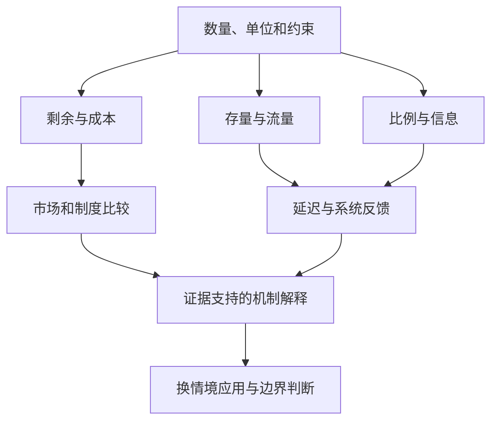
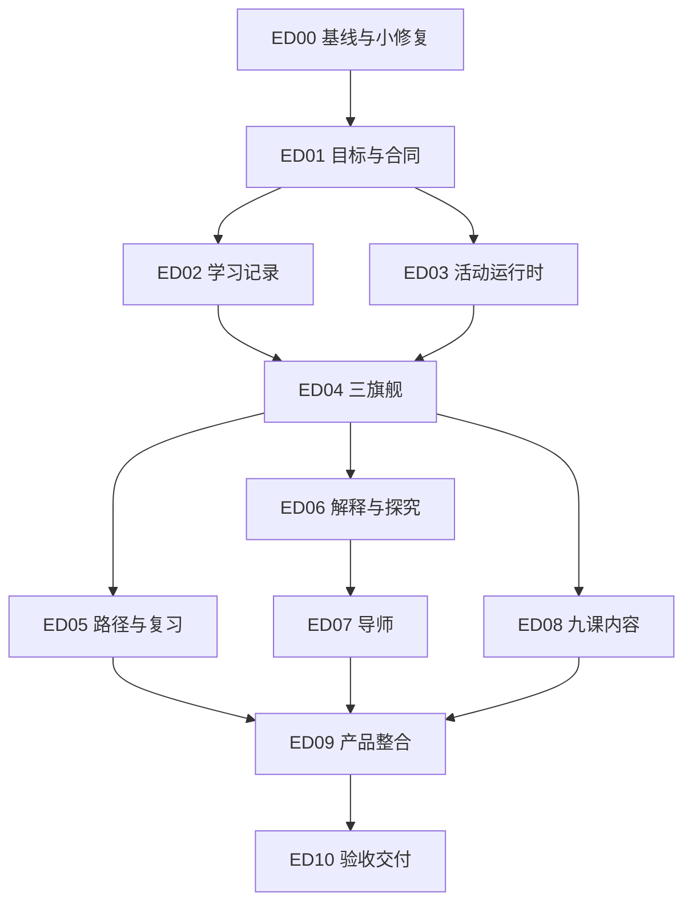

# EcoSimEdu：教育产品能力深化升级计划书

**版本：2026-11-18 · 第二轮产品升级 · 供产品决策、教学内容开发与 Codex 实施使用**

代码审计基线：`bfe31dd945eaff3cac7c92a580974ad1e3cd45e2`。仓库：[DengJunxian/EcoSimEdu](https://github.com/DengJunxian/EcoSimEdu)。本轮交付是经过代码审查与资料研究的升级方案和执行提示词包，未修改、提交或部署用户的产品源代码。

## 阅读导航

1. 决策与审计：第0–1章。
2. 产品PRD、教育机制、页面与指标：第2–5章。
3. 三门完整示范课、十二课矩阵与概念连接：第6章。
4. 数据、活动、迁移、双模式与导师技术合同：第7章。
5. ED00–ED10依赖、工时、验收、Skills与Codex使用：第8–12章。
6. 研究与代码来源：第13章。完整独立提示词另见EcoSimEdu_Codex_Prompts.md。

本计划的代码事实、设计判断、未来门槛和未验证项分别标明。示意图为目标设计，不是当前产品截图。

## 0. 决策摘要

**建议把下一版本的目标定为：帮助学生从“完成一门经济仿真实验课”，走向“能够独立解释、计算、检验和迁移经济机制”。**

现有产品已经跨过“只有仿真 Demo”的阶段。独立首页与案例库、十二门分阶段课堂、差异化领域画面、主体行动、原预测与修订、参数对照、事件证据和解释笔记均已进入代码。继续把首页、七阶段、双模式或参数台当成全新建设任务，会重复投入。真正需要补齐的是学习目标、任务证据、误解诊断、跨课联系、复习与下一步决策。

本轮产品策略采用三个连续问题：

1. **进入前：我为什么学这课，学完能做什么，需要什么基础？**
2. **学习中：我在哪一步理解错了，怎样通过行动和证据纠正？**
3. **离开后：我能否换一个问题独立应用，下次应该练什么？**

建议保留当前 12 个正式案例、26 个候选案例资料资产与四个多角色 Live 方向；优先深化现有内容。先以双向拍卖、SVB、Schelling 三课完成可验证闭环，再推广其他九课。基础模式仍承担全部正式自主学习路径；高级 LLM 模式服务于已有机制的进一步探索。

### 本次必须作出的产品取舍

| 决策 | 本轮选择 | 产生的产品价值 | 需要承担的成本 |
|---|---|---|---|
| 产品组织 | 案例入口 + 能力连接 + 学习路径 | 兼顾故事吸引力和系统学习 | 要给目标、任务、概念建立稳定关联 |
| 内容增长 | 深化已有 12 课，候选库保留研究状态 | 每课都有独立任务、解释和迁移 | 新课数量暂不增加 |
| 学习状态 | 活动完成与学习证据分开 | 学生知道做过什么、还缺哪种练习 | 新增学习记录与旧数据迁移 |
| 教学交互 | 七阶段保留，阶段内允许多个活动 | 能加入例题、补救、退架和短复习 | 需要解除固定七个 scene 的限制 |
| 个性化 | 可解释规则与本地记录 | 无 API、无账号也有下一步建议 | 不提供未经校准的掌握概率 |
| AI 导师 | 依据学生回答与可见证据追问 | 将 API 用于具体教学帮助 | 开放解释必须保留自评与人工判断边界 |
| 发布评价 | 机制可靠、路径可达、任务有效、证据真实分项验收 | 避免技术测试替代教育判断 | 经济学内容审阅要作为独立工时 |

### 本轮交付底线

- 12/12 正式课可以无外部 API 完成；原模型与运行记录不被换成假响应。
- 12 课各有 3 条可观察目标，共 36 条课程目标；每条目标对应活动与评价证据。
- 每课有一个可核验的独立计算、构造或判断任务，以及近迁移与条件辨认任务。不同课程使用合适题型，不靠大量二选一充数。
- 三旗舰实现“初次尝试→误解反馈→有帮助的练习→新变式独立应用→解释→迁移→复习”。
- 全部课程保留数据身份、原预测、可见范围、引用核验和必要模型边界。
- 学习状态与推荐有证据和原因；旧草稿不会自动变成“已掌握”。
- 每个 ED 工作包都包含具体 Skills 执行、运行验证和交接要求。

## 1. 当前代码审计：先确认已有进步，再选择真正缺口

### 1.1 核验范围和证据等级

本轮读取当前主分支固定提交、根 `AGENTS.md`、相关依赖与配置、12 份 `lesson-v2.json`、12 份模型说明、学习首页/课堂/状态/笔记/参数/助手实现及升级验收文档。相较上一轮基线 `dc288b8`，当前提交合并了 UP11 分支，差异为 145 个文件、15,277 行增加和 207 行删除。差异规模只是版本背景，不能说明教学效果。

| 事项 | 本轮证据 | 正确表述 |
|---|---|---|
| 前端依赖与构建 | `npm ci --ignore-scripts`、`npm run build` 成功；93 个模块 | 当前学生前端可以构建 |
| 机制与契约 | 本轮实际执行 309 项，通过；36.44 秒 | 所运行范围内回归通过 |
| 课程内容 | 12 份包均通过当前内容契约；84 场景、74 题、160 选项 | 当前结构完整，结构通过不等于教学充分 |
| 三个助手探针 | 当前数值核对、解释反馈和初始处理提示存在具体限制 | 有可复现改进依据 |
| 仓库既往验收 | 文档记录 412 项、浏览器状态和 VoiceOver 等 | 属于历史收据，本轮没有重复完成全部 |
| 当前浏览器体验 | 尝试启动预览，但浏览器无法连接当前运行服务 | 本轮不声称完成视觉或端到端浏览器验收 |
| 真实供应商 L2/在线导师 | 本轮未使用真实密钥；仓库也保留部分未验收状态 | 协议实现与真实供应商效果分开报告 |
| 真实学生效果 | 未提供真实学习者数据 | 无法据此宣称改善留存或学习成绩 |

证据文件在本包 `evidence/`，详细审计在 `docs/education-upgrade/`。只读审查结束时源仓库工作树未改动。

### 1.2 应保留的基础

| 能力 | 当前实现依据 | 下一版本怎样复用 |
|---|---|---|
| 首页、案例库、详情、路径、笔记 | `student-web/src/app/pages.tsx`、`app/shell.tsx` | 调整信息优先级，显示能力目标、下一步与复习 |
| 十二课七阶段与领域视图 | `cases/*/lesson-v2.json`、`student-web/src/cases/` | 阶段内扩展活动，保留已有领域组件 |
| 拍卖计算、SVB 分类与权益计算、邻域判断 | `auction-explain.tsx`、`svb-panel.tsx`、`neighborhood-view.tsx` | 接入统一学习证据，添加渐隐提示与平行变式 |
| 原始预测、信心、修订与事件回查 | `flagship-study.ts`、`flagship-lesson.tsx` | 保留初始想法，并记录理由、帮助程度与后续变化 |
| 严格运行引用核验 | `flagship-notes.tsx`、`auction-notes.tsx` | 作为解释卡的来源底座，另行检查论证质量 |
| 成对参数实验、经济时钟与五种子核对 | `parameter-lab.tsx`、`parameter_specs.py` | 增加实验问题、处理变量、控制理由、反证和结论 |
| 离线分层提示 | `task_tutor.py`、`tutor.tsx` | 进一步针对具体误解与活动提供帮助 |
| 四案 L2 协议 | `live_l2.py` | 保留进阶模式、成本与降级，不牵制基础教育升级 |
| 概念搜索、收藏、教师与导出工具 | 旧 `lab-tools.tsx` | 迁入新版信息架构，避免重复开发 |

### 1.3 当前最值得修的七类问题

**一，题目存在明显位置线索。** 74 题中有 62 道概念题、12 道预测题；62 道概念题全部二选一，其中 56 道正确答案排在第一项。当前直接按配置渲染。应保留少量适合概念对照的二选一，增加数值、排序、构造、证据匹配和新情境判断。无顺序意义的选项可按尝试稳定随机化，并存 `option_id`；不能刷新就换序，也不能把带逻辑顺序的选项盲目打乱。

**二，有反馈文本，尚无跨课学习诊断。** 136 个选项已经有 `criterion`，不能再说“完全没有判据”。现有前端没有把这些判据、计算活动和提示使用接入同一概念证据记录。应规范 `concept_id`、`outcome_id`、`item_id`、任务家族、尝试历史和反馈来源。

**三，七阶段被固定成七个场景。** `lesson_scenes.py` 强制 ID、顺序与 next 等于原七阶段，状态限制 `unlocked <= 6`；新增一个补救场景会失败。升级应保留 phase 与旧链接映射，允许一个 phase 中有若干 activity，并提供短补救返回。不必开发任意流程编辑器。

**四，课程目标没有贯穿产品。** 案例已包含 goals，但新版详情尚未显示；四条路径是有序案例列表，48 个课内概念词尚无先修/对照/任务关系。需要让“学什么—做什么—凭什么判断”贯穿详情、课堂、个人记录和推荐。

**五，笔记引用真实，不等于解释正确。** 现有 run/hash/version/event 校验有价值；开放文本仍主要靠自评。助手请求也没有完整笔记和尝试历史。应分别显示“引用可核对”“结构完整”“概念需复核”，避免一枚绿色勾代表所有质量。

**六，在线导师的当前增益有限。** `tutor_online.py` 合法输出只是 `observation_first` 或 `inspection_first`，选择两段已验证内容的呈现顺序。它不是已经能够诊断学生解释的通用经济学导师。可先改好离线误解反馈，再用可选模型分析结构化草稿、提出追问。

**七，两个导师提示会误导正常探究。** 在当前现金确为 0 时，问“银行现金为 0 吗”被数值正则一律拒绝；比较提示统一要求初态一致，却与现有 `initial_treatment` 相冲突。应在 ED00 完成小范围修复并加对应回归；复杂解释能力留到后续阶段。

### 1.4 本轮技术选择

继续采用当前 React/TypeScript/Vite 学生端、Python 仿真服务、SQLite 运行存储和 Case Package。研究端 Streamlit 继续独立。不为当前需求引入全新前端、微服务集群、向量数据库、账户体系或概率知识追踪服务。按统一教育契约，学习事件存入同一个 IndexedDB，经济运行继续由原服务管理；是否使用轻量封装库，可按追加记录、迁移和导入事务的需求作出简短 ADR。存储对象和状态以 `education-contracts.md` 为准，不另建一套并行合同。

## 2. 产品 PRD：让学生知道自己为什么做每一步

### 2.1 产品定位与主用户

产品承诺：**从有依据的经济问题出发，做一个决定，追踪互动与总体结果，写出可核对的机制解释，再在新问题中检验。**

| 用户情境 | 待完成任务 | 产品要给出的帮助 | 成功产物 |
|---|---|---|---|
| 零基础、对新闻好奇 | 理解事件为何发生 | 具体角色、可跳过的术语短练、少量控制项 | 一段含主体、约束、互动和边界的解释 |
| 正在学经济学的本科生 | 找到自己概念或计算上的错误 | 定向诊断、例题退架、平行题、公式与图像连接 | 一次新情境独立应用与错误修订记录 |
| 跨专业探索者 | 检验自己的经济直觉 | 原预测、证据选择、控制变量和反证问题 | 可复现的实验卡与有条件结论 |
| 已学过几课的自学者 | 连接概念并保持可用 | 概念档案、短复习、桥接题、明确推荐原因 | 跨课迁移任务和持续学习路线 |
| 轻教师 | 演示和讨论一个机制 | 暂停点、展示模式、同源活动页 | 10/20/40 分钟展示组合 |

用户情境是设计假设，未冒充已经完成访谈。产品发布不以班级管理、作业后台或正式考试为前置。

### 2.2 首次使用与十分钟价值设计

首页保持现有清晰入口，提供“从一个问题开始”“按路径学习”“自由探索”。可选两到四分钟的基础自检；不要求注册、不把自检变成入场考试。熟悉概念的用户可直接进课。

建议双向拍卖作为默认短体验。以下是设计预算，不是目前测得的完成时间：

| 时间预算 | 学生动作 | 学习目的 | 界面控制 |
|---|---|---|---|
| 0–1 分钟 | 看到自己的私人价值、现金与数量限制，选择报价 | 认识个人目标与交易约束 | 突出自己的角色与一个问题；对手成本保持未知 |
| 1–3 分钟 | 提交预测和理由，运行到第一次与本人相关的成交或未成交检查点 | 让原有直觉可观察 | 结果出现前保留预测，不提前泄题 |
| 3–5 分钟 | 从已可见成交回到订单；在允许揭示的解释阶段核算剩余 | 连接价格、价值、成本 | 利用现有拍卖视图与手算组件 |
| 5–7 分钟 | 改变一种费用条件，比较未成交与分配 | 区分转移与效率变化 | 一项必要对照；其他深入对照可选 |
| 7–9 分钟 | 做一个不同数字的小市场任务 | 检验独立应用 | 无预填答案，提示可打开但记录帮助 |
| 9–10 分钟 | 写一句机制解释、查看下一步 | 将操作转为可回看的作品 | 展示已获得证据与尚待验证目标 |

若学生需要更久，系统保留当前位置和已完成活动。短体验不是宣称十分钟掌握经济学，而是让学生形成一次有内容的初步成功。

### 2.3 核心学习路径与可选深入

现有四条主题分组保留为浏览入口；新增可执行路径定义，不必对十二课做一条唯一线性课程。

| 路径 | 推荐课程顺序 | 先修提示与短练 | 路径挑战 |
|---|---|---|---|
| 价格、信息与交易效率 | 双向拍卖 → 柠檬市场 → 碳市场 | 价值/成本、机会成本、简单剩余 | 比较价格制度在信息与外部性条件下能解决什么 |
| 局部行为与集体结果 | Schelling → 信息级联 → 公共物品 | 比例、概率直觉、私人/群体收益 | 找出三个模型共同的聚合结构及不能类比的差别 |
| 金融中的信息与流动性 | SVB → 闪电崩盘 → GameStop | 资产负债表、订单簿、保证金短练 | 对同一个“流动性不足”表述区分三种机制与证据 |
| 制度、资源与系统协调 | 公共物品 → 公地治理 → 学校匹配 → Beer Game | 存量/流量、资源约束、偏好与优先序 | 提出一项制度改变，并说明受益、成本与适用条件 |

跨路径的课程可以复用，不复制学习记录。先修是一项建议与补救入口；不把兴趣探索锁死。路径图标注三种边：**建议先修、同一概念的另一应用、形成对照**，禁止把所有概念联系都画成前置关系。

### 2.4 必须与可以分开

每课分别声明完整体验所需活动与支持学习证据的条件，落实到统一契约的 `LessonActivity.completion_rule` 和 `LearningOutcome.evidence_requirement`，不新增另一套必需字段。必要内容通常包括一个预测、一个相关操作、一个机制观察、一项与目标对应的对照和一项独立任务；完整看完所有动画、每个参数都跑一次不应成为通用规则。个别课程目标确需比较两种制度，则在目标和计划中明示。

学生允许答错、选择不知道、跳过拓展、先继续探索。主任务未答也能继续浏览或探索，该活动保留待完成或已跳过状态，不产生独立证据。必要条件用于判断能否称为完整体验或证据充分，不作为答题正确才能前进的导航锁。结果页诚实显示“实验已完成；两项能力已有独立证据；一项仍建议练习”。核心能力未验证时不伪装全通关，也不把自学变成强制考试。

### 2.5 页面与功能优先级

| 页面/模块 | 学生最重要的问题 | 本轮具体改变 | 优先级 |
|---|---|---|---|
| 首页 | 现在该做什么 | 继续核心任务、一个待复习、一个下一课；每项说明依据 | P1 |
| 课前详情 | 能学到什么 | 直接显示现有 goals，再映射可观察能力、先修、作品与时长预算 | P0 |
| 任务式课堂 | 为什么做这一步 | 当前问题、领域画面、回答动作、反馈、下一步；一次凸显一个任务 | P0 |
| 概念页 | 我理解得怎样 | 具体情境/图像/形式化/边界四种表征，连接实际尝试与解释卡 | P1 |
| 学习记录 | 我做过与能做到什么 | 活动进度、独立应用、迁移、待复习分开；按概念及案例查看 | P0/P1 |
| 解释卡 | 证据怎样支持结论 | 主张、证据、微观机制、聚合机制、条件、替代解释 | P1 |
| 实验台 | 怎样检验我的解释 | 在现有参数台加入实验卡，结果可带回课堂 | P1 |
| 学习助手 | 我卡在哪一步 | 针对实际回答追问；先本地反馈，再可选模型建议 | P1 |
| 教学展示 | 如何组织讨论 | 整合旧展示能力、暂停点、答案显隐与活动页 | P2 |

### 2.6 课程覆盖与产品承诺的边界

目前十二课的优势是市场交易、信息、金融流动性、社会互动和制度比较。它们不能替代完整的本科微观/宏观教材；GDP、通胀、就业、增长、财政与货币政策尚缺同等深度的正式教学。产品应称“通过案例学习核心经济机制”，不要把目录包装成已覆盖整门经济学。

26个候选案例继续作为内容资产。待十二课达到本轮门槛后，按“填补课程缺口优先于新鲜题材”评审下一批：先考虑家庭异质性与财政退税，再评估银行—企业—家庭的货币政策传导，随后是网络产业/供应链的补充。每个新课仍需独立目标、真实来源、可验证机制和离线闭环；相关模型未实现前只展示资料状态。正式发布数量不因增加候选卡片而增长。

### 2.7 保持探索吸引力，避免把课堂变成答题器

保留具体角色、可选择行动、原预测与意外结果的张力。练习只在帮助解释当前经济问题时出现；短体验优先一个核心疑问，深入模式再展开理论与多种制度。学生可以先看一个完整例子，也可以直接尝试；不强迫失败后才能看解析。

给学生有意义的选择：选择观察哪个主体、提出另一种解释、修改一个制度、保留尚不确定的结论。成就感来自“我的解释被证据修正”“我能在另一情境算清楚”，界面可展示学习作品与进步；不需要排行榜、强制连胜或虚构掌握百分比。教学难度是推理逐渐独立，而不只是增加按钮、文字或题数。

## 3. 教育体系：以可观察能力组织教学

### 3.1 五类核心能力

1. **表征能力：** 找出主体、资源、约束、信息和目标；在故事、图表、账表和公式之间转换。
2. **机制解释：** 说明个人激励或预期如何经互动影响群体结构与总体指标。
3. **经济计算：** 在明确单位、时间、制度和假设下计算剩余、收益、存量变化或匹配结果。
4. **实验推理：** 提出可检验预测，区分处理与共同输入，使用反事实及反证解释结果。
5. **迁移与边界判断：** 将机制用于新情境，同时指出与原模型不同的条件。

这是面向产品的五类能力分组，与教学附件的六类操作标签映射：表征对应 `identify`，机制解释覆盖 `trace/explain`，经济计算对应 `calculate`，实验推理对应 `design`，迁移对应 `transfer`。不建立两套竞争的能力状态；实际目标、任务和证据都落在统一 `LearningOutcome` 合同。

记住术语有作用，但不是每课的最终成果。每课三条目标用可核验动词表达，例如“给定账表和提款需求，计算现金缺口并判断净资产是否为负”，避免仅写“理解挤兑”。

### 3.2 对原七阶段的教学深化

| 现有阶段 | 新增关键活动 | 产生的证据 | 允许的帮助 |
|---|---|---|---|
| 问题与角色（intro） | 诊断直觉、选择问题、认识资源与约束、必要例题 | 原始判断与基础表征 | 生活化词汇、独立教学示例，遵守信息范围 |
| 预测行为（predict） | 预测 + 原因 + 指标/观察窗口 | 可比对的预期与依据 | 不提示未来运行结论 |
| 选择行动（bid） | 在预算或制度约束下作出本次行动 | 行动与理由、当时可见信息 | 显示自己的可选范围，不揭示对手私有条件 |
| 互动演化 | 在教学事件暂停，检查一个因果步骤 | 主体行动、边界内可见证据 | 指向画面中的可验证位置 |
| 解释涌现 | 半完成例题 → 独立变式 → 解释卡 | 规则评分与解释 rubric 分开 | 逐步撤除提示 |
| 反事实 | 提出假设、选处理、核对结果和反证 | 实验卡、配对证据、条件化结论 | 显示共同条件和真实 treatments |
| 总结迁移 | 新情境任务与下次复习安排 | 迁移证据、仍待练目标 | 先独立，再可查笔记 |

一个阶段可以包含多个活动。补救不是惩罚：错误后可以选“看一个例子”“回到这条证据”“换一道题”或“继续探索”。先做浅分支与固定返回点，限制补救链深度，避免学习迷宫。

### 3.3 支架与评价方式

采用“完整示例—补全一步—自己完成—新情境应用”的变化，而不是每个页面都用相同题型。三个旗舰已有计算/分类/邻域组件，可以直接承担中间两步。

完整例题若需要同时展示买卖双方价值或成本，应使用明确标识的独立教学练习；当前运行中的对手私有数据仍服从原角色权限和揭示时点。进入例题、补救或复习不能扩大该运行的可见范围，也不能将编写的小题当成当前运行的一帧。

选择题适用于区分常见误解；数值题检查量纲、符号与运算；排序/构造题检查机制顺序；证据任务检查主张与数据的关联；开放解释保留表达空间。解释 rubric 至少包括主体/约束、机制连接、证据适切性、条件与替代解释。自评、规则评分、人工审阅和 AI 建议须标明各自来源。

**学习证据分层：** 见过内容、在帮助下完成、独立应用和跨情境应用保留各自记录；生产主状态统一为 `not_attempted / practicing / independent_evidence`，辅助程度在尝试中记录，迁移使用独立 `transfer_status`，复习到期由 `ReviewSchedule` 表示。到期不把已有能力自动清零。一次正确选择、一次碰巧预测成功、看过答案后重选，都不能单独作为独立理解证明。

### 3.4 教育研究依据与适用界限

美国 IES/WWC 的学习组织指南支持将例题与练习交替、连接具体与抽象表征、采用检索性练习、间隔安排及深层解释问题；其中不同建议的证据等级不同。[R01] 这些原则用于选择产品方法，不构成本产品效果已被验证的证明。

Roediger 与 Karpicke 的原始研究表明，在其文本学习实验中，练习提取对延迟保持具有价值。[R02] Butler 的四项实验研究了不同程度的新推断问题迁移。[R08] 因此本方案安排先独立回答、再看帮助，并把同题修订与新情境表现分开。研究的具体材料与实验条件并非 EcoSimEdu 真实学习情境，不能直接搬用其效果量。

复习间隔、题数和首访时间均是可调整的产品规则。当前不引入未经数据校准的知识追踪概率，也不要求正式教学实验作为上线前置。可用性走查与经济学内容审阅仍需完成。

## 4. UX 与页面交互设计

### 4.1 信息架构

主导航使用：**开始学习、学习路径、案例库、我的学习**。保留“实验室”作为明确可见的进阶入口。概念搜索进入全局搜索；每课保留案例资料、模型边界与展示方式。技术细节在需要复现时展开，不占据初学者第一视野。

建议路由为：现有 `/`、`/cases`、`/cases/:id`、`/paths`、`/learn/:id`、`/notes`、`/compare`、`/experiments` 保持；增量增加 `/concepts/:id`、`/practice` 与 `/review`。`/notes` 可逐步成为“我的学习”中的作品页，旧地址保留重定向或兼容。

### 4.2 核心课堂布局

- **顶部：** 本课问题、学习目标、当前阶段。不要同时展示五六个百分比。
- **左侧/移动端顶部：** 可折叠的阶段与活动目录，显示当前任务、可选拓展、保存状态。
- **中央：** 当前领域画面和一个主要学习动作。宏观异常点击仍可追到群体和主体。
- **右侧/移动端下方：** 当前问题、作答和分层反馈；“解释为什么”比通用聊天更突出。
- **底部：** 回放时间线及继续动作；读屏可识别状态。观测证据可直接加入当前解释卡。

不要让学生同时填写长笔记、调全部参数、读长理论和看运动图。活动切换时明确焦点，内容保存后再进入下一步。理论推导和数学层随需展开，初学者与进阶用户共享同一结果身份。

### 4.3 六个页面的具体交互

| 页面 | 首屏关键模块 | 主要动作 | 完成/异常状态 |
|---|---|---|---|
| 学习首页 | 当前目标；继续；一项复习；下一课 | 开始一项具体活动 | 冷启动、旧记录、已完成、存储不可用、内容升级、无到期任务 |
| 课程详情 | 经济问题；三目标；先修；主线时长预算；将产出什么 | 直接开课/基础短练 | 资料缺失不能无标识进入正式目录；可返回旧草稿 |
| 任务课堂 | 单一问题；领域视图；回答；提示 | 提交、查证、重试或继续 | 不知道、答错、提示后答对、未来信息未揭示、运行失败 |
| 解释卡 | 主张；证据；机制；边界 | 从视图添加证据、检查、修订 | 引用失效/缺失，结构完整但待概念复核，AI建议被采纳/撤回 |
| 概念页 | 一个日常例子、一张机制图、一种形式表示、条件 | 查看我的证据，做新变式 | 尚无证据、辅助完成、独立成功、迁移待练、复习到期 |
| 实验卡 | 问题与预测；处理；共同条件；结果；结论 | 在原参数台运行，带回课堂 | 参数不支持、处理多因素、结果未发生、原运行已不可用 |

### 4.4 状态与视觉语言

继续沿用现有视觉语言，增加统一语义：内容身份、运行状态、学习证据三类标记用文字和图形区分，不能只靠颜色。历史背景与仿真结果标记独立于“完成/待练”。未答、错误、未知和无数据分别呈现。

目标参考：正文 16–18px、阅读宽度约 65–75 字符；主操作明确，数学变量与账表对齐；320px 窄屏可以完成核心动作；键盘操作与焦点可见；动态图支持减弱动画和暂停。它们属于待实现与实测的设计要求，不是本轮浏览器已通过的声明。

新增组件建议：`LearningGoalCard`、`ActivityRenderer`、`FeedbackPanel`、`EvidenceStatus`、`ExplanationCard`、`ExperimentCard`、`NextActionCard`、`ReviewQueue`。命名为实施建议，以现有组件复用优先。避免把同一课另写一套“新版”和“高级版”页面。

## 5. 产品指标与验收逻辑

### 5.1 当前没有真实基线

不能根据代码审计声称学生留存低、流失发生在某一幕或成绩会提升某个百分比。以下指标是将来可采集的定义；当前基线为“未采集”。默认记录留在本机，只收集完成学习功能所必需的事件；若未来需要集中产品分析，再明确选择加入、用途和保留期。不得将学生自由文本或模型密钥默认发送到统计服务。

### 5.2 指标树

| 层级 | 指标 | 分母与解释 | 产品用途 |
|---|---|---|---|
| 学习证据 | 独立迁移任务达标率 | 分母为首次独立提交且可按明确标准评价的有效迁移任务，按本地档案×目标×版本去重；分子为其中达标项。辅助提交、曝光未知和开放文本自评分开报告 | 判断桥接教学和任务是否需要修订 |
| 学习保持 | 延迟复习首次独立表现 | 定义窗口内实际尝试的到期任务；并报尝试覆盖和间隔 | 决定短复习与再次讲解的安排 |
| 过程 | 学习闭环形成率 | 已启动主线者中形成预测、观察、解释和迁移尝试；非空文字不算质量判定 | 定位流程阻塞 |
| 过程 | 帮助后新变式表现 | 用过帮助者在后续未暴露变式的首次表现 | 判断支架是否支持独立应用 |
| 体验 | 首次形成机制解释的活跃时间 | 同时报未达成者；排除长时间离开 | 调整首访任务与页面负担 |
| 工程 | 离线可达、记录迁移、引用真实性 | 按明确验收样本和操作核验 | 阻断严重退化 |

前两项必须并列报告“启动到提交/到期到尝试”的覆盖率，以及全部提交中符合独立判据的覆盖。未回来的人不是自动答错；只统计答题者也不能推广到所有人。开放解释只有自评或 AI 建议时，不进入客观达标率的分子或分母，单列完成与自评情况；没有可评价样本则显示尚无数据。同题重答、看过答案和自评不能混成独立能力分数。重复事件不增加人数；浏览器档案不宣称真实独立用户。

### 5.3 产品完成与学习有效分开

工程验收可保证功能真实运行、目标有任务、错误路径有帮助、记录和解释来源可追溯。经济学审阅可检查解法、机制和条件。实际学习增益需要学习者数据，本轮不以未实施的研究结论作宣传或放行依据。

## 6. 三个旗舰与十二课的具体教学设计

以下数值题是可核算的独立教学小题，均非历史观测。真实运行练习继续从 run 绑定字段取数。可选完整学习预计 25–35 分钟，属于待实测的设计预算；快速探索保留原路径。

### 6.1 双向拍卖：为什么成交更高价，不一定创造更多剩余？

**复用**：`AuctionExplain` 的成交结算输入、边际配对；现有角色 B01、订单→成交定位、需求与费用对照、证据笔记。新做的是支架层级、尝试记录和迁移，不替换订单簿。

**信息可见性**：下列完整算式中的双方价值与成本来自独立编写的教学小题，界面明确标“教学练习，非当前运行”。学生在当前运行的导入、预测和报价阶段只能看到本角色被授权的信息，不得因加入例题而暴露实际对手私人成本或全市场私人价值。真实运行的双方结算/完整供需仍遵守现有收盘或明确复盘权限；进入桥梁、补救或复习不能自动扩大 `reveal` 窗口。

**三个正式目标**：AUC-1，计算买卖双方与平台收益并对账；AUC-2，从实际订单/成交与边际配对解释配置结果；AUC-3，在制度对照和新情境中区分支付转移、资源成本与条件。下述各项是这三个目标的具体表现，迁移题不再另造第四个总目标。

**A. 前置诊断（约 2 分钟）**

- 买家现金 500、私人价值 108，最高愿付是否就是 500？正确：预算给出支付能力，私人价值与其他条件约束愿付；不能将现金全当商品价值。
- 成交价提高 5，买卖双方总剩余一定提高 5 吗？给定价值、成本和交易数量不变，正确为总剩余不变；价格重新分配双方收益。
- 错误者进入 2 分钟“价值、价格、成本”桥梁；成功者直接行动，不需完整重做。

**B. 完整例题（约 3 分钟）**

一件商品，买方价值 110、卖方成本 80、成交价 96，每方付平台费 4，平台不发生本题之外的资源消耗。

| 计算对象 | 算式 | 答案 |
|---|---|---:|
| 买方剩余 | 110−96−4 | 10 |
| 卖方剩余 | 96−80−4 | 12 |
| 平台收入 | 4+4 | 8 |
| 三方合计 | 10+12+8=110−80 | 30 |

先让学生指出 96 在谁的账里增加/减少，再展开完整算式。自解释问题：“为什么汇总后价格抵消？哪项题目条件让平台收入可以直接合入总剩余？”参考：相同支付一出一入；这里平台没有另计资源成本。

**C. 部分填空（约 2 分钟）**

价值 108、成本 84、价格 96、每方费 2。显示买方 `108−96−2=10`，让学生补卖方与平台：10、4，总计 24。误填卖方 12：提示“卖家还承担哪一笔支出？”误填平台 2：提示“本题几方付费？”第二提示给 `2+2`，完整答案由用户主动展开。

**D. 独立变式（约 3 分钟）**

价值 103、成本 82、价格 94、每方费 3。隐藏例题答案，要求算三方收益并写总剩余。正确为 6、9、6、21。若只答总数 21 而分配错，标“总量计算正确，分配仍需核对”，不把三项合并成一个模糊错误。

再问：同一交易价格改为 97，其他不变，新的三方收益为 3、12、6，合计仍 21。该变式检验支付转移，避免机械照填。

**E. 回到真实实验（约 7 分钟）**

选择实际成交，使用现有表单独立核对；若 B01 未成交，允许选另一笔并解释 B01 未成交，不编造结果。随后在“费用”对照前填写：处理变量为每方交易费；共同条件为初态、种子与学生开局报价；观察指标为交易数量、三方剩余、未实现边际机会。若两组交易数相同，比较分配；若数目不同，从实际缺失的可行交易追踪，不能仅凭“费↑”预填福利下降。

**F. 解释 rubric（0/1/2 为本任务锚点，不作为人格或总体能力评分）**

| 维度 | 0：未提供 | 1：部分到位 | 2：可复核 |
|---|---|---|---|
| 论断 | 只有“好/坏” | 指出价格/成交变化 | 明确对象、指标和对照条件 |
| 证据 | 没有实际记录 | 引用但未说明作用 | 一笔交易/未成交与一个对照点支持论断 |
| 推理 | 将支付全算资源损失 | 会算但未连接规则 | 说明价值成本、支付抵消和交易机会变化 |
| 条件 | 外推到所有市场 | 泛称“模型简化” | 指出费的去向、行为策略或资源成本条件 |

示范好答案应随真实事件生成字段，不写固定“成交减少”。参考骨架：“同样初态下，费用改变了____。事件____显示____，由报价与结算规则____可解释。这条结果支持本规则下____；平台成本或报价策略改变后须重新检验。”

**G. 近迁移与远迁移**

- 近迁移：价值 96、成本 92，双方各费 3；若买卖双方都坚持非负剩余，可接受价格区间存在吗？买方要求 `p≤93`，卖方要求 `p≥95`，无重叠。无费用时 `[92,96]` 可交易。该小题显式加入非负剩余行为条件，不强行解释所有现有代理策略。
- 远迁移：二手教材平台收取 6 元费用，其中 2 元支付新增验货耗材、4 元为平台净收入。和模型的“纯转移费用”有何不同？在价值与成本界定不含验货耗材的前提下，2 元是真实资源耗用；4 元为账户分配。不能把全部 6 元都当社会损失，也不能全部当无成本转移。

**H. 复习（单次 2–3 分钟）**

下一次返回时给新数值算式，稍后再给“涨价是否创造剩余”的一句解释。推荐碳市场：“把支付转移与资源成本用于配额交易”；或柠檬市场：“当实际质量变化，低价还是否代表高剩余？”

### 6.2 SVB：银行有正权益，为什么工资仍可能不到账？

**复用**：`SvbPanel` 的资产负债分类与 `Ledger` 权益输入，申请→部分付款→待付链、正权益待付定位、消息来源边、现金缓冲/网络对照。新做支架、账表变式和流动性概念迁移。

**三个正式目标**：SVB-1，用账表和申请记录区分申请/实付、现金/权益及各类变化；SVB-2，以实际消息、规则、申请与支付证据解释传导；SVB-3，设计或解释资产组合/网络对照并判断迁移条件。历史与教学数据身份是三个目标共同遵守的质量条件。

**A. 诊断**

- 银行借入 5，现金增加 5，权益是否增加 5？正确：借款负债同增，权益当时不变。
- 申请提款 18 但只收到 8，银行存款负债是否已经减少 18？正确：按本课规则只因实付减少 8，10 仍待付。
- 错误时先做两侧账户拖放/键盘分类，保留原 `classification` 组件；不立即堆叠整张账表。

**B. 完整例题：沿用模型说明的可手算结构**

初始：现金 10；证券 2 单位，每单位现值 9；贷款 22；存款负债 40；支持借款 0。先算权益 `10+18+22−40=10`。

| 依次发生 | 现金 | 证券市值 | 贷款 | 存款 | 支持借款 | 权益 |
|---|---:|---:|---:|---:|---:|---:|
| 初始 | 10 | 18 | 22 | 40 | 0 | 10 |
| 借入 5 | 15 | 18 | 22 | 40 | 5 | 10 |
| 卖一单位证券，收到 6 | 21 | 9 | 22 | 40 | 5 | 7 |
| 实付提款 12 | 9 | 9 | 22 | 28 | 5 | 7 |

解释：借款带来同额资产负债；急售相对当前市值损失 3；实付使现金与存款同减。不把证券重估与实际出售混为一笔。表格显示每一步变化，再显示不变项，支持键盘操作。

**C. 部分填空**

新账表：现金20、证券市值30、贷款50、存款80、借款0，权益20。依次：借入10；出售账面10的证券收到8；实付25。

- 借入后现金30、借款10、权益____ → 20。
- 卖出后现金38、证券20、权益____ → 18。
- 付款后现金____、存款____、权益____ → 13、55、18。

误把借入记为利润：先显示借款到期要还的一侧；误认为付款损益：让学生同时圈出现金和存款两项，第二提示再给算式。

**D. 独立变式**

新账表：现金12、证券28、贷款40、存款65、支持借款5。权益为10。当前唯一新申请18，实际支付8，没有其他待付：新现金4、新存款57、待付10、权益仍10。要求解释为什么“有10权益”和“尚待付10”可以同时成立。正确理由：权益包括不能立即拿来付款的资产，待付表示未兑付请求；两者恰好相等不构成恒等规律。

后续单独追加一步：借入12后现金16、支持借款17，权益仍10。不能把“融资成功”直接推成“银行已经没有风险”。

**E. 实验任务**

先用现有实际运行定位 D01 申请与实付，不要求每个种子都出现同一事件。再找正权益和待付共存的结算帧；若未发生，记录缺事件并按真实账表解释。实验计划分两次：改变初始现金组合；改变每人观察对象。注意现有现金缓冲组同时减少证券敞口，因此应表述为“初始资产组合的总效应”，不能说纯粹现金作用已经与重估暴露完全分离。

信息解释要求学生指出：一条消息来源、接收者当时知道的内容、模型中的风险规则、申请后银行的支付约束。时间上接续不等于后面所有提款都由 D01 造成。

**F. 解释 rubric**

| 维度 | 达到本任务的标准 |
|---|---|
| 账表 | 用实际一帧算出权益，现金/证券/贷款与两种负债口径齐全 |
| 支付 | 用同一 request_id 分开申请、累计实付、剩余，不重复扣存款 |
| 机制 | 把一条可见信息与实际规则连接，再接到请求和现金约束；承认工资等其他原因 |
| 对照/边界 | 指明处理变量与资产组合影响；只解释本模型，不填入历史 SVB 财报 |

给两段相近的解释让学生比较：“借入资金使银行更富有，因此不会挤兑”与“借款增加当期现金，同时增加负债；能否付清仍由现金、申请规模和支持上限决定”。让学生改写前者，而不是只选对后者。

**G. 近迁移与远迁移**

- 近迁移：银行 A 现金0、其他资产120、负债100；银行 B 现金30、其他资产50、负债100。仅依本题资产估值和支付规则，谁权益为正、谁能即时支付10？A权益20但无可用现金；B权益−20但现金足够支付该笔。正确结论区分两个维度，不把能付一笔当总体偿付安全。
- 远迁移：企业有下月到期应收款、本周工资与有限现金。相似机制是现金流时间错配；差异包括银行存款契约、存款保险、监管和支持工具，不能直接用储户挤兑的机制取代客户/供应商契约分析。问题要求列一项相似和两项需重建的前提。

**H. 复习与跨课**

延后小题先不显示公式：借款、重估、实付分别改变哪些量？然后在啤酒游戏分辨“订单”和“到货”；去闪电崩盘比较“银行可用现金不足”与“市场订单深度不足”。二者都涉及流动性，但含义和观测指标不同。

### 6.3 Schelling：每个人能接受少量同组邻居，整体为什么仍会分化？

**复用**：九格点选练习、30/50% 阈值判断、A001 开局动作、受影响邻居前后比、满意率/同类邻接率、三阈值同初态对照。重点是把既有局部计算组织为“局部规则—邻居外部影响—总体指标—路径条件”。

**三个正式目标**：SCH-1，选对分母并计算邻居变化前后的阈值状态；SCH-2，用真实迁居链连接局部影响和总体指标；SCH-3，通过同条件对照、终止原因及新情境判断适用边界，避免从图案反推真实动机。

**A. 诊断**

原九格中央 A；周围 2A、4B、2空位。分母6而非8或9；中央不计。按至少30%同组，`2/6≈33.3%` 满意；至少50%则未达标。继续复用现有点击分母的针对性反馈，并持久化到统一 attempt。

**B. 完整例题**

让一名 B 邻居迁出。中央不动，A数仍2，已占邻居变5，比例变40%。如果阈值为40%，中央由未达标变达标；如果阈值50%，仍未达标。显示同一个变化在两个阈值下的不同判断，明确“有邻域变化”不必“满意状态变化”。

**C. 部分填空**

新邻域 3A、2B、3空位：`同组数____ / 已占数____ = ____%`，正确3/5=60%。最低60%时满意；“至少”包含相等。然后只保留公式不提供分母，要求自行圈出计数对象。

**D. 独立变式**

新邻域2A、3B、3空位，阈值50%。初始2/5=40%，未达标。一名B搬走后2/4=50%，达标，中央没有搬家。学生须独立填写两比例、状态和一个因果连接：“他人迁居改变了我的邻居集合与分母”。

第二题使用边界位置，明确只有可见格子参与；没有邻居时比例不报告，依本课规则视为满意。模型约定与数学中的除以零不能混为一谈。

**E. 真实实验与反事实**

复用受影响居民表：先演示一名真实邻居，再隐藏另一名的答案让学生选一条事件复算；验证完成后显示实际前后值。比较相同初态下0%、30%、50%，先预测“自动迁居数、终止原因、同类邻接率”，再运行。0%可能不自动迁居，因此原有格局不会自动消失。学生开局动作仍单列；不把它说成自动规则的结果。

全图解释必须核对两种分母：满意率按人，同类邻接率按已占格间的无向边。不能直接对每个人局部比例做简单平均就当全图边比例。达到轮数上限时应写“尚未稳定”，不能把停止当均衡。

**F. 解释 rubric**

| 维度 | 达标锚点 |
|---|---|
| 局部规则 | 给出一名居民的正确分母、比例和阈值判断 |
| 相互影响 | 引用一条搬迁及一名未搬者的前后邻域，判断是否越过阈值 |
| 总体结果 | 使用满意率和同类邻接率的不同口径，报告真实终止原因 |
| 迁移边界 | 至少说明住房可选集、价格/收入或制度历史可能产生相似格局，需要独立资料 |

自解释追问：“如果每个人都满意，这张地图还能有哪些分布？”要求举一个反例，如各组内部聚集而各自满足阈值，避免只复述“微观不等于宏观”。

**G. 近迁移与远迁移**

- 近迁移：初态已经分为两个社区，把阈值改0且无学生搬家。是否一定形成均匀混合？不会；所有自动居民已满足最低要求，没有自动迁居驱动力。
- 远迁移：看到校园社团按专业分群，能否仅凭图判断成员排斥其他专业？不能；课表、地点、朋友介绍、共同兴趣可形成相似结构。让学生选一个能区分机制的证据，例如相同机会下的选择记录，或控制课程安排后的互动变化，而非笼统“需要更多数据”。

**H. 复习与跨课**

复习用新邻域，保留空位、边界和相等阈值中的一个变化；另给“个体都满意→全体混合”的反例题。推荐信息级联：“相同总体图案可能由不同信息机制产生”；推荐公共物品：“个人判断如何汇总为群体结果”。

### 6.4 十二课学习能力深化矩阵

每课先落实三项核心成果，不以总题数为目标。下表的独立任务必须有参考答案或明确量表，数据来自标识清楚的编写小题或实际运行。

| 课程 ID | 核心概念/能力 | 已有可复用动作 | 关键误解 | 新增独立任务 | 迁移与跨课 |
|---|---|---|---|---|---|
| `double_auction` | C02/C03/C14；算剩余、解释配置 | 成交核对、边际配对、两制度对照 | 报价=成交价；价格↑=总剩余↑；费全是资源损失 | 新数值拆三方收益；找一项未实现配对并说明行为条件 | 二手平台资源成本；碳市场支付与效率 |
| `svb_run` | C04/C05/C08；账表与传播 | Ledger、申请/实付/队列、消息边 | 借款=权益；申请=支付；先发生就造成全部后来行为 | 借款/急售/实付三步账；选一条消息与规则连接 | 企业现金时差；啤酒订单/到货；闪崩流动性辨异 |
| `schelling_segregation` | C06/C07/C18；局部汇总 | 九格、受影响邻居、三阈值 | 个人满意=混居；停止=均衡；图案证明偏好 | 未搬居民前后比例；同终局不同机制的反例 | 校园社团/产业位置，须补选择机会资料 |
| `information_cascade` | C08/C17；信息与推断 | 私人卡、行动链、两潜在动作、核验 | 三个相同行动=三份独立信号 | 公共A赔率1/4，私信号A似然比2，个人赔率1/2、概率1/3，仍选B；若两信号均选B，该行动不更新公共20% | 多篇文章引用同一报告不等于多份证据；GME话题传播 |
| `public_goods` | C03/C09；边际激励与净福利 | 四人贡献/惩罚账、制度对照 | 贡献提高必使净收益提高；罚他人与付惩罚成本混同 | g=(0,10,12,20)，G42，回报16.8；P4付2惩罚P1罚6，P1净30.8/P4净14.8，群体97.2；解释成本抵消贡献收益 | 共享厨房清洁：收益、执行成本、可观察性变化 |
| `commons_governance` | C04/C09/C10；资源反馈 | 取用/再生双事件、管护账户 | 存量=申请总量；按期初再生；罚款全是资源消耗 | S100,H20,K240,r.55，R80,G29.333…，S′109.333…；若罚款5转管护、检查2，群体只因检查成本减2 | 地下水/水渠须核对季节、权利和人口；公共物品辨别竞争性 |
| `lemons_market` | C02/C11；参与选择与福利 | 愿售池、退出、结算、认证 | 退出=售出；降价=买方剩余上升 | q=1..5各一件：混合价3.6→愿售1..3→2.4→1..2→1.8→1→1.2；解释数量构成变化 | 二手设备认证：认证可信度与成本不同，不能直接推保修无条件改善 |
| `school_matching` | C12/C16；机制与公平口径 | 申请/拒绝/暂留、两种阻挡对 | 首志愿提高校方优先；暂留=录取；稳定=人人首选 | 用三人缩小表手推两轮DA，找即时接受的S01-B阻挡对；分别用真偏好/申报评价 | 实习匹配有岗位容量/排序；夫妻联报等约束须重新建模 |
| `beer_game` | C04/C13/C18；动态库存 | 订单→发货→到货批次、库存位置 | 下单=库存；在途=全部已订未到；方差比分母0写0 | 在库7、已订未到11、积压4，库存位置14；若实物在途6，未发部分5；说明重复补单如何放大后续库存 | 疫情供应链中需求冲击与产能限制分开识别；SVB请求/兑现 |
| `carbon_market` | C02/C03/C15；边际配置与分配 | 边际成本滑块、配额登记/缴回 | 免费配额↑=行业上限↑；支付全计资源成本 | 两厂E0各4、k2/8、总配额5；选3吨边际1,3,4→减排2/1、成本8；固定技术总量改免费分配仅改变净支付 | 固定总量与按产出/强度分配辨异；拍卖的转移与资源成本 |
| `flash_crash` | C07/C14/C17；市场深度 | 做市库存、撤单、程序队列、同步步 | 撤5股=成交5股；无成交沿用价=当前新价格；暂停永久消压 | 给前深度20、成交3、撤单5、无新增：深度12、成交增3；标记最后价来自哪笔trade | 跨市场闪崩需独立时钟和路由；SVB与订单簿流动性不同 |
| `gamestop` | C08/C14/C17；动机与账本分离 | 话题源、成交目的、借券/担保/归还 | 触达人数=买股；担保要求=已还券；价格图证明全部动机 | 借10股、回补成交4但归还3：仍欠7、持有待归还1；分别引用三事件；真实市场动机不可套模型标签 | 网络热度与购票/消费，相关传播不等于成交原因；信息级联 |

公地与公共物品必须保留资源是否具有竞争性的区别；学校匹配的稳定性与“社会公平”不可合并；碳市场必须明确当前是集中求解的成本最小化教学基准，不描述成已仿真所有企业议价后自动发现同一均衡。第 6–12 课的题目参考解随已有机制版本核对，不能复制一套“参数增加→指标增加”的通用答案。

### 6.5 概念连接与短桥梁

#### 概念与能力 概念和能力分开建模

概念回答“学什么”，能力回答“会如何使用”。同一个概念可在多个案例出现；同一案例可练计算、解释和比较，不能只用案例 ID 代表能力。

下列 18 个概念是本次归并草案，ED01 应根据课程目标进一步合并或拆分；概念数量不作为验收指标。初版稳定要求是 12 课各 3 个可观察目标，共 36 条目标—活动—证据映射，可以共享概念。

| 稳定 ID（拟议） | 概念单元 | 首次建立/再次应用 |
|---|---|---|
| C01 | 资源、约束与机会成本 | 拍卖、公共物品、GME |
| C02 | 边际量、交易剩余与配置效率 | 拍卖、柠檬、碳市场 |
| C03 | 账户转移与实际资源成本 | 拍卖→公共物品/公地→碳市场 |
| C04 | 存量、流量与账户平衡 | SVB→啤酒游戏/公地 |
| C05 | 流动性与偿付能力 | SVB；与闪电崩盘的“市场流动性”辨异 |
| C06 | 局部比例与总体统计 | Schelling→信息级联/GME 的汇总口径 |
| C07 | 阈值、反馈与涌现 | Schelling→SVB/闪电崩盘 |
| C08 | 信号、相关信息与信念更新 | 信息级联→SVB/GME |
| C09 | 私人激励与集体收益 | 公共物品→公地 |
| C10 | 共同池资源与再生 | 公地治理 |
| C11 | 信息不对称与参与选择 | 柠檬市场 |
| C12 | 偏好、优先序与稳定匹配 | 学校匹配 |
| C13 | 延迟、库存位置与动态反馈 | 啤酒游戏 |
| C14 | 订单簿深度、成交与市场流动性 | 拍卖→闪电崩盘/GME |
| C15 | 排放约束、许可分配与成本效率 | 碳市场 |
| C16 | 处理变量、控制条件与反事实 | 所有案例；由具体预设上升到学生设计 |
| C17 | 证据、机制解释与因果边界 | 所有案例 |
| C18 | 模型条件、路径差异与不确定性 | 所有案例 |

能力维度采用六类，不直接合成为单一分数：`identify` 识别变量/口径；`calculate` 计算与对账；`trace` 追踪微观到总体的关系；`design` 设计比较；`explain` 用证据解释；`transfer` 换情境应用并识别边界。

这张图用于设计顺序，不是把六门前置课设为硬锁。强先修边应保持无环，跨课类比和辨异另用关联边。路径页默认展示“你要解决的问题—三个学习单元—最后能完成的任务”；完整概念图放在展开层。

#### 数学和推理桥梁 五个可跳过的数学和推理桥梁

| 桥梁 | 2–4 分钟任务 | 首次触发 | 可跳过的依据 |
|---|---|---|---|
| 比例与分母 | 点出分母对象，算 2/6，与 30% 比较 | Schelling | 一个新邻域独立判断成功 |
| 存量与流量 | 将“余额、申请、实付”放入正确时间格 | SVB | 一组到账前后账表独立核对 |
| 边际与总量 | 从两档增加量累加总成本 | 拍卖/碳市场 | 新数值边际题正确并说明单位 |
| 条件概率 | 以自然频数呈现两箱和一次信号，再转为赔率 | 信息级联 | 能区分状态概率与信号准确率 |
| 对照与推断 | 在两组设置中找处理变量和共同条件 | 首次 compare | 能辨认混合改变多个参数的比较 |

微课的目标不是教授一套数学课，而是让当前经济学任务可理解。每个桥梁共享“看一个例子→补一步→自己试→回到案例”的界面。数学符号旁保留单位与一句语义解释。

详见独立教学说明中的反馈、实验卡、迁移与复习实施细节；全部工程字段以第7章唯一契约为准。

## 7. 教育能力增量技术架构

**状态：架构提案，未接入生产。** 基于提交 `bfe31dd945eaff3cac7c92a580974ad1e3cd45e2`；配套 `contracts_example.json` 为合成示例，不是学生记录、历史数据或新增运行。首三个旗舰统一为双向拍卖、SVB、Schelling；以双向拍卖做纵向样板，再验证两种不同领域，随后推广十二课。

### 一、边界与落点

保留现有 Python 仿真服务、React 学生端、SQLite 运行库、领域视图与结果契约。教育增强增加内容声明和本地学习状态，不增加微服务、账号或教师管理。原 `lesson-v2.json`、`FieldStudy`、`AuctionStudy` 及旧 URL 继续可读；规则计算、预计算回放和 Live 仍遵守各自能力范围。

建议新增 `schemas/learning/*.schema.json`、`cases/<id>/learning-v3.json`、`content/concepts.json`；Python 在 `services/simulation/learning_content.py` 校验引用，前端在 `student-web/src/learning/` 增加 `activity-runtime`、`assessment`、`learner-repository`。这些是建议文件，不是现存模块。现有 `/api/cases/{id}/lesson` 默认继续返回 v2；可用显式 `schema_version=3` 请求新包。未升级案例继续走原课堂。

### 二、十个最小对象

| 对象 | 必需字段 | 约束与用途 |
| --- | --- | --- |
| ConceptDefinition | `id, version, label, definition, prerequisite_ids, misconception_codes` | 稳定概念 ID；前置关系无悬空、无环；定义与题目版本分离 |
| LearningOutcome | `id, version, concept_ids, performance, evidence_requirement` | 写可观察表现，如“根据现金和净资产区分流动性不足与资不抵债”；不能只写“理解银行” |
| AssessmentItem | `id, version, variant_id, family_id, outcome_ids, kind, prompt, context, response_schema, evaluator, feedback` | 类型先做单选、数值、机制排序、结构化解释；确定性评价声明 evaluator 版本；开放文本只做结构反馈，不能冒充语义评分 |
| LearningAttempt | `id, schema_version, local_profile_id, session_id, case_id, content_version, activity_id, item_id, item_version, variant_id, presented_order, response, submitted_at, exposure, assessment_role, evaluation, source_refs` | 一次正式提交为一条不可变记录；改答案产生新 attempt，不覆盖首次答案；结果保留 evaluator 版本 |
| LearnerEvidence | `outcome_id, rule_version, evidence_state, supporting_attempt_ids, unresolved_misconception_codes, transfer_status, updated_at` | 派生缓存，可从尝试重建；主状态未尝试/练习中/有独立应用证据，迁移为单独维度；不输出未经校准的掌握概率 |
| LessonActivity | `id, phase, kind, outcome_ids, content_ref, assessment_item_ids, next_activity_id, completion_rule` | 可选 `remediation_activity_id, return_activity_id`；只做主线及短补救，不支持任意脚本执行 |
| ExperimentCard | `id, version, case_id, question, hypothesis, treatment_plan, controlled_inputs, outcome_metric_ids, falsification, run_ids, actual_treatments, alignment_ref, conclusion, limitations, status` | 运行前保存预测；运行后由后端返回填实际参数差异和来源，不让学生手输“实际结果”冒充系统记录 |
| ExplanationCard | `id, version, case_id, content_version, outcome_ids, claim, source_refs, mechanism_steps, conditions, alternative_explanation, feedback, updated_at` | 结构化解释；反馈区分结构完整性、事实核对与尚待人工/独立任务验证的机制推理 |
| ReviewSchedule | `id, outcome_id, rule_version, due_at, based_on_attempt_ids, status` | 本地复习计划；到期只标待复习，不删除历史证据或把能力降为零 |
| Recommendation | `id, outcome_ids, activity_id, reason_code, source_attempt_ids, priority, created_at` | 简单可解释的下一步；显示推荐原因及可替代活动，允许学生自由选择 |

独立编写教学题统一使用 `AssessmentItem.context.kind = authored_model_exercise`；这不是历史观测或仿真实帧。真实运行绑定题使用独立的运行上下文与有效SourceRef。

评估选项使用稳定 `option_id`，选择题响应保存该 ID，排序题保存 ID 数组；展示顺序另存 `presented_order`。不能把“A/B”或数组下标当答案。选项换位置不产生新变式；题干、答案依据或反馈实质变化提升 item.version，旧尝试仍使用旧版本解释。

`LearningOutcome` 要与学习活动及评估任务建立映射。先给每个核心目标至少一个独立题和一个边界/迁移任务；是否新增更多题由具体错误覆盖决定，不能拿题数作为教育质量。

### 三、七 phase 与多 activity 状态

沿用 `intro → predict → bid → observe → explain → compare → notebook` 七个 phase，名称兼容旧实现；`bid` 在界面可显示本课的“选择行动”。每个 phase 可含多个活动，旧 scene 通过一对一 adapter 变成活动。

新 SessionState 保存 `current_activity_id, accessible_activity_ids, activity_states, return_stack, run_context, content_version`。活动状态使用 `available/in_progress/submitted/completed/skipped`；学习状态与概念证据分别计算。补救最多一层，明确返回点，不递归堆叠。`completed` 表示完成该活动要求，不等于答对或掌握。学习者可以带着“待验证目标”继续主线。

领域面板仍读取当前 phase 对应的旧索引 adapter，不立即重写十二个领域组件。只有活动编排脱离 `stage === 4` 之类的位置依赖。回放状态 `tick/revealed/pinned`、run 引用与活动切换分开存储；进入补救或复习不能增加 reveal 上限。修订预测必须保留第一次提交和当时信心。

### 四、提示与答案暴露的判据

一次学习尝试从显示题目开始，到首次提交结束。暴露事件在显示提示或答案**之前**写入本地事务；保存 `max_hint_level, answer_seen, exemplar_seen, prior_feedback_for_variant, solution_seen_at, exposure_unknown`。暴露作用域是题目/变式和当前尝试，不把此前学过相关概念当成作弊或自动判辅助。

- 提交前打开该题提示、示例解或答案：本次是 assisted。
- 该变式此前已展示答案/反馈，再次作答：repeated；不贡献新的独立证据。仅打乱选项不能改变此判定。
- 新变式在无本题提示、答案和暴露不明状态下首次提交：可标 independent；仍要满足目标证据要求。
- 迁移题必须由内容作者明确标为 transfer，并改变情境或机制应用条件；换数字不自动成为迁移。
- 预测碰巧正确不提升概念证据；学生需在后续任务给出机制或边界解释。

提示不能被禁用来“制造独立性”。学生始终可求助，只需诚实记录辅助条件。用户可自行修改本地数据，本方案用于自主学习而非认证考试，不承诺防作弊。

首版证据规则是可解释的产品规则：主状态使用 `not_attempted / practicing / independent_evidence`，对外为未尝试/练习中/有独立应用证据；独立任务达标才进入第三种。迁移使用单独 `transfer_status=not_assessed / evidenced / needs_more_evidence`，复习状态由 ReviewSchedule 提供。显示支持的尝试和日期；一次正确不宣布永久掌握。出现新错误保留已有证据，同时添加需再练目标，不删除过去表现。复习日期采用明示、可调整的简单间隔；不能宣称已验证的个性化记忆模型。

### 五、本地存储与兼容迁移

使用单一 IndexedDB `ecosimedu-learning`，最小 object stores 为 `sessions, attempts, exposures, evidence_cache, experiments, migration_backups`。匿名 local_profile_id 随浏览器生成，不要求姓名。经济运行继续留在现有 SQLite，学习记录保留 SourceRef。配额不足/事务失败须明确提示并允许导出，不能先显示“已保存”。

另把 ExplanationCard、ReviewSchedule、Recommendation 放入对应的同库集合；它们不建立新的服务。学习页显示“此浏览器的记录”，提供统一导出及删除入口。试用演示会话和自己的学习会话使用不同 profile，避免演示填满个人进度。导出文件包括内容版本、原始尝试、解释卡和迁移凭据；不导出 API Key。运行数据库需单独备份，导出说明必须说明引用与运行的关系。

迁移过程：读取旧 key → 用现有解析器验证 → 保留原 JSON 与摘要 → 在单个新库事务中创建会话、原笔记和 legacy 状态 → 校验后写 migration receipt。原 key 不删除，重复迁移按原 key+摘要幂等，失败可继续旧课堂。旧 stage/unlocked 只转成访问位置与可访问活动；first/latest 保留为 legacy_response，因缺少完整暴露历史，`exposure_unknown=true`，不生成独立证据或掌握状态。

内容版本变化保留原笔记和题目版本；有显式活动迁移表才续接新活动，否则提供导出与原版查看。导入先校验 schema、ID、版本及引用，合并按 attempt.id 去重，不覆盖另一条同 ID 不同内容的记录。来源数据库缺失时允许保留学习文字并标“运行待恢复”；不得用演示运行补齐旧来源。

区分四类版本：存储结构 schema_version、课程 content_version、题目 item.version、证据派生 rule_version。文案小改不能静默改变已提交答案的判定；评估器修正生成新 evaluation 版本并保留原结果及更正原因。不同题目版本是否可共同支持同一个目标，必须在内容包声明兼容关系。缓存重算不能重写尝试、首次预测、暴露事件或旧评价。

### 六、SourceRef 与实验设计复用

原 `flagship-study.ts:5–8` 的 `SourceRef` 原样复用：`run_id, case_version, engine_version, result_hash, seq, tick, event_type, actor?`。引用校验沿用 Notes/Restore 的 run/hash/event/主体匹配。AuctionEvidence 转为 SourceRef 时保留原 metric/unit/value 扩展，actor_id 显式映射 actor，不改历史对象。只有已核对来源才能用于运行事实评价；引用真实不代表学生因果解释成立。

L2 未完成前缀不能把 `prefix_hash` 填成 `result_hash`。首批学习证据使用标准已完成离线运行；高级运行先保留独立实验记录，后续通过专用完成结果适配器再接入正式证据判定。

ExperimentCard 从现有参数规格读取 `comparison_class`，从 `/compare` 读取 actual_treatments、两侧初态哈希与经济时钟。政策对照保持定义要求的共同初态；initial_treatment 明确哪一部分初态被处理、哪些种子/人口/冲击保持。多个处理同时改变时提示不能把差异唯一归到一个变量；五种子只称小样本稳健性探索，不包装为总体显著性。

### 七、Tutor 增量输入与两项修复

保留旧 TutorRequest；新增可选 `learning_context`，包含 `activity_id, item_id/version, response, exposure, attempt_summary, explanation_draft, rubric_id, experiment_card_id`。说明草稿限长；摘要只含本次目标需要的最近尝试，不默认发送全部笔记。服务器用案例/题目 ID 重新读取 rubric，不能信任客户端自报正确答案或来源。

数值问题先解析已登记指标、单位、时点，读取已揭示 frame：单位一致且数值满足该指标声明的绝对/相对容差才确认；有差异则指出来源与正确值；歧义就追问。不能取消未来、私有和跨运行限制，也不能仅凭字符串数字相等通过。浮点容差按指标定义，不统一给所有货币/人数同一容差。

对照提示按实际 comparison_class 生成，替换 `task_tutor.py:235–237` 的统一“初态相同”。开放解释优先给结构反馈和一条针对性追问；可选 LLM 返回结构化 claim/evidence_id/feedback_kind，来源不存在或越界就丢弃该条并回退本地。LLM 不改变运行数据或最终学习证据状态。

### 八、高价值验收

1. 同题错答→看反馈→改对，保留两条尝试且不新增独立证据；换选项顺序不改变判定。
2. 新变式独立通过、另一情境迁移通过，分别更新证据状态并能解释依据；预测正确不直接升级。
3. 七 phase 中增加补救活动后，返回位置、已揭示时点和 pin 不丢；旧 URL 与十二课回放回归通过。
4. migration 中途失败与重复执行不丢旧笔记，不把旧完成进度变成掌握率；版本不同不静默重评分。
5. 本地事务失败不显示保存成功；重复导入去重，冲突与缺失运行分别显示。
6. 现金确为 0 的合法询问可确认；未来数据、错单位、其他 run 与隐藏主体仍拒绝或追问。
7. 现金再配置/空间初态对照说明正确保持条件；多因素结果不能生成单因素归因。
8. 无 API、助手超时、坏引用时仍完成三个旗舰全部学习闭环；在线反馈不自动形成已掌握状态。

### 九、三个旗舰怎样证明契约有用

双向拍卖先检验“成交不等于获利、报价不等于成交”：首次选择后保留错误及反馈暴露，用新交易条件检验剩余计算和费用解释。需要区分学习者算对一个数字、能说明一笔交易的机制、能解释全市场资源配置三个目标，避免一项结果代替全部能力。

SVB 检验“现金不足与净资产不同”：把资产负债表和到期支付放入结构化解释卡，在现金再配置对照中明确变动的是资产构成。学生只有引用正净资产不能证明任何银行永远安全；只有看到待付也不能推出资不抵债。迁移任务可换成供应商的短期支付约束，并保留未知资产价值。

Schelling 检验“局部满意与总体分化不同”：让学生定位一个迁居怎样改变邻居条件，再比较相同阈值的两种初始布局。独立任务考察局部变量与总体指标的区别，迁移题检验结论依赖的邻域、空位和迁居规则；不得把该简化模型解释成现实群体偏好的测量。

三个旗舰使用同一尝试与证据契约，但保留各自的领域计算和解释要求。样板通过后再增加其他九课的目标映射、题目变式和误解规则。验收评审应抽取真实学习路径检查“推荐为什么出现、反馈指出了什么、学生怎样改进”，不能只检查 JSON 字段齐全或页面多了一张卡片。

### 十、实施衔接与专业流程

开发者先读取项目 AGENTS 和当前可用 Skills，再按任务分别选择实际可读的内容研究、数据质量、前端和测试能力；缺失能力采用常规工程方法并记录。内容作者先定义目标与误解，工程把它映射到真实指标和事件，可视化再决定如何让学生找到证据，测试最后核对行为和学习证据一致。每轮提交只宣称已经验证的阶段，样例或接口未接线时明确标为提案。

先提交兼容解析器和数据迁移，再在一个旗舰接活动运行时、作答与解释卡，然后跑不同领域的两个旗舰回归。禁止仅根据新 Schema 将旧答案批量判为正确，禁止通过补造运行来让迁移测试通过，禁止把在线助手输出直接写成权威能力判断。涉及版本和引用失败时优先保留原记录、给出恢复途径。

本附件的实施验收以运行证据为准；示例 JSON 能解析和引用自洽不等于功能已经开发、迁移已经发生或教育效果已经验证。

## 8. 工程路线图：每个阶段交付一个学生能使用的增量

本轮使用 **ED00–ED10** 编号，避免与仓库已经完成的 UP00–UP11 混淆。已有工作不会因为新编号被自动重做。Codex 开始时重新核对 HEAD 和已实现范围，当前固定提交是审计锚点而不是强制回退版本。

### 8.1 工作包、依赖与成果

| 工作包 | 学生可见成果/工程目标 | 主要依赖 | 实施工作 | 预计工程人日 | 放行标准 |
|---|---|---|---|---:|---|
| ED00 基线与教学误导修复 | 合法数值询问得到核对；初始处理对照得到正确提示 | 当前主分支 | 验证当前差异、Skills、基线；修两项窄范围导师问题；维护教育升级进度 | 1–2 | 既有测试不退化；0现金、错单位、未来值、初始处理样例通过；明确未验证项 |
| ED01 目标、概念与题目蓝图 | 详情显示能做什么；三旗舰有目标—任务对齐预览 | ED00 | 12课三目标；规范概念ID/误解；新增兼容学习内容合同、作者校验器、题序审计 | 3–4 | 无悬空目标；三旗舰蓝图与真实规则相符；详情可浏览；不批量重写模型 |
| ED02 学习记录与证据 | 每次尝试、提示与独立表现可恢复 | ED01 | 追加尝试、暴露事件、本地事务、版本与旧数据迁移、派生状态 | 4–6 | 看答案后重答不变成新独立证据；旧笔记不丢；事务失败有恢复 |
| ED03 多活动课堂与补救 | 七阶段内可看例题、练一步、补救返回 | ED01，接ED02 | 兼容活动运行时、四类核心题型、现有证据选择复用、必要/可选任务、焦点/保存 | 5–7 | 拍卖一个闭环可运行；新增第八活动不再破坏旧课；不泄漏未来或私有信息 |
| ED04 三旗舰教学深化 | 拍卖、SVB、Schelling完整独立应用与解释 | ED02、ED03 | 复用手算/分类/九格，增加变式、针对性误解反馈、参考解与迁移 | 5–7 | 三课错误→帮助→新题→解释→迁移全部离线；学科机制与答案逐项核验 |
| ED05 路径、首页与复习 | 知道继续哪里、为什么复习、下一课是什么 | ED04 | 目标选择、先修短练、规则推荐、本地ReviewSchedule、概念与作品索引 | 4–6 | 六类首页状态；推荐有原因且可跳过；时区/跨天/内容升级正确 |
| ED06 解释与实验探究 | 参数台结果带回课内解释；跨课迁移 | ED04，ED02 | ExplanationCard、ExperimentCard、已核对SourceRef桥接、控制/处理说明、三组跨课挑战 | 4–6 | 引用有效与解释质量分开；预测不后填；多因素结果不假装单变量结论 |
| ED07 导师教学能力 | 针对本人回答的提示与追问 | ED04、ED06 | 内容化误解规则、结构化学习上下文、离线反馈、可选LLM草稿建议 | 4–6 | 无Key可完成；正确/错误草稿有针对性反馈边界；坏引用/超时有降级；不改学习证据判定 |
| ED08 其余九课与内容质量 | 十二课都拥有完整学习资源包 | ED04；使用ED05/06/07稳定合同 | 按课程族扩展九课；近迁移/条件辨异；来源/答案/语言审阅；质量校验工具 | 6–9 | 12/12离线闭环；各目标有任务；非复制题；数据身份与机制正确 |
| ED09 产品整合与教学展示 | 新导航、概念/收藏/展示/导出统一 | ED05–ED08 | 整合旧LabTools；移动端、键盘、减弱动画；设计规范与错误恢复；活动页 | 3–5 | 三端尺寸/键盘关键通路；旧链接保留；展示档案隔离且不回滚个人提示暴露 |
| ED10 综合验收与部署 | 可独立安装、学习、备份和恢复的完整版本 | ED00–ED09 | 内容审阅、机制/契约/E2E、迁移与备份、离线包、性能预算与交付文档 | 3–5 | 当前提交的收据齐全；未通过的Live或浏览器项明确保留；无虚假通过 |

**工期口径：** 合计 42–63 工程人日，含实施及基础内容接入，不包含独立经济学/教学内容审核的 6–10 人日。另建议为旧状态迁移、浏览器适配和内容修订预留约 25% 工程风险储备（约 11–16 人日）。这些是基于当前可复用资产的估算，不是 Codex 固定速度承诺。两名工程实施者加能及时响应的兼职经济学审阅，约 6–9 个工作周；单人顺序推进约 12–18 周。先完成垂直样板即可分批交付，无需等全部结束才看到产品。

ED08 的 6–9 人日依赖 ED01 已有完整蓝图、原机制无需重做、审阅并行及时。如果重新写模型或增加新课，应单列估算，不挤进现有范围。

### 8.2 并行策略与集成点

ED02 与 ED03 先共定事件合同再分工；ED05 与 ED06 可并行，ED08 的研究/撰写可提前、接线需等待共同合同稳定；ED09 设计走查可前置但最终验收在内容到位后进行。不要让多个代理同时重写 `flagship-lesson.tsx` 或共享 Schema；分配明确文件所有者，集成者负责兼容测试。建议每个合并请求围绕一条学生路径，避免一次改写全部十二课。

### 8.3 分批发布

- **M0：基线可信。** ED00 完成，已有产品仍可运行，两个具体误导已修。
- **M1：一课闭环。** ED01–ED03 接通拍卖最小学习过程，用户已能看到实际变化；不等完整课程生产。
- **M2：三个领域通用。** ED04 完成，三课证明合同适用于市场、银行和空间模型。
- **M3：连续自主学习。** ED05–ED07 完成，推荐、复习、实验与解释连起来；剩余九课保留原版可用路径。
- **M4：十二课完整升级。** ED08–ED10 完成，整体发布；在线真实供应商收据与离线正式教学分别标注状态。

### 8.4 风险与处理

| 风险 | 提前信号 | 处理方式 |
|---|---|---|
| 内容数量替代教学质量 | 每课看起来都有三目标但任务相同 | 每课抽一条独立解题与错误路径做人工学科审阅 |
| 新活动架构引发重写 | 同时替换所有领域面板 | 保留phase adapter，先一课，逐课接入 |
| 学习状态过度推断 | 看答案改对也显示已掌握 | 暴露记录先于显示；独立/重复/辅助判定可重放 |
| 旧数据丢失 | 迁移前删除旧key或覆盖版本 | 备份、事务、幂等、保留旧页可读、显式迁移表 |
| 默认私有信息被教学题提前揭示 | 例题直接引用未公开对手值 | 独立练习独立身份；源引用严格服从揭示范围 |
| LLM占据核心链路 | 提示离线不可用或无Key无法结课 | 作者反馈与规则优先；模型只作为可选建议 |
| 同一词误用到所有案例 | 将银行现金与订单深度当同一变量 | 概念页显式辨义；跨课迁移题必须包含不同条件 |
| 日程变成无意义打卡 | 以签到次数代替任务表现 | 可暂停复习，按具体证据推荐，不设强制连胜 |
| 工期低估内容审核 | 九课临近上线仍无答案解析 | ED01锁蓝图，审核工时单列，未审内容不进正式目录 |

## 9. 测试与产品验收方案

### 9.1 四类质量分别评价

1. **经济机制正确：** 守恒、单位、时间、交易与账表规则、对照身份和随机复现。
2. **教学任务有效：** 学习目标有对应表现，问题有可核对解法，反馈针对真实误解，迁移不只换标题。
3. **交互可完成：** 学生能独立进行核心流程，错误/不知道/未发生事件均有出口，键盘与窄屏可用。
4. **学习证据诚实：** 辅助、答案暴露、首次、重复、迁移、版本、自评与AI建议有清楚边界。

本轮已有 309 项通过不能替代未来新增功能验收。未来测试数量可变化，以风险覆盖和当前提交的收据为准。

### 9.2 必要回归与新增测试

| 范围 | 必须覆盖的失败路径 | 验收证据 |
|---|---|---|
| 内容合同 | 无目标任务、悬空概念、错误先修环、无返回补救、未支持参数、未标练习数据身份 | CLI报告定位到案例/活动/字段，构建或发布检查失败 |
| 题目 | 稳定选项ID、无意义重排不算新变式、容差/单位、信息不足、多个合理答案 | 纯函数/契约测试与已算参考解 |
| 尝试与暴露 | 首次错→反馈→改对；刷新再答；例题答案已在上下文；存储失败时求助 | 记录不覆盖、帮助不被抹掉、独立证据不误升 |
| 活动运行时 | 第八个活动、短补救返回、未答/答错仍可继续、跳过、恢复旧URL、观察中暂停 | E2E与可见范围合同；继续不伪造提交或独立证据 |
| 学习证据 | 一道预测猜中、同题重复、旧记录导入、规则修订、后续新错误 | 状态可解释且保留历史；没有伪掌握概率 |
| 复习 | 不同本地日、时区切换、提前/到期/延后、内容升级、暂停 | 可控时间测试，不通过真正等待多天验收 |
| 解释卡 | 引用存在但与论断无关；有效引用+错误机制；缺失运行、旧版本 | 身份验证与语义评价分开，不伪给正确 |
| 实验卡 | initial_treatment、policy_comparison、多因素、同结果、事件未发生 | 实际处理与共同条件来自服务；不后填预测 |
| 助手 | 现金为0、单位错误、未来值、提示注入式题文、错误草稿、无Key、超时、坏引用 | 数值核验可复现，离线降级完整，LLM不能改账本或证据状态 |
| 兼容 | 旧版笔记、重复迁移、中断迁移、导入冲突、运行库缺失、配额不足 | 备份/收据/错误恢复，原记录不丢 |
| UI | 320/768/1440宽度、键盘、读屏标签、减弱动画、结果图无数据 | 实际浏览器任务记录；无自动重大可访问性违规，人工核心操作确认 |
| 部署 | 无外部网络和Key、本地启动、备份恢复、旧链接、资料本地可读 | 新环境操作说明和真实运行收据 |

题目数据与内容JSON不能执行任意脚本；只允许已注册的纯函数评估器。参考答案本来可在本机查看，产品定位为自主学习而非安全考试；不增加防作弊架构。

### 9.3 三条端到端验收脚本

**路径一：价格与剩余。** 新用户→拍卖课目标→只看到自己可见信息→先提交预测与理由，再确认报价并运行→观察实际成交或未成交→在获准解释阶段核算一笔交易→针对一项错误看提示→用不同条件题独立作答→把实际对照加入解释卡→完成平台费用新情境题→首页显示获得何种证据及下一步。断言：换选项顺序不构成独立变式；无成交不伪造；费用去向与资源成本区分；独立小题中的双方数据不泄露当前未公开对手信息。

**路径二：挤兑与账表。** SVB背景→现金/负债短练→预测提款→查申请/实付/待付→核算正权益与支付约束→比较现金资产组合处理→修订“借钱等于盈利”的解释→在企业支付时差情境中辨同异→复习队列出现短任务。若本次没有正权益与待付共存帧，按实际账表与支付结果完成解释，不制造指定现象。断言：引用真实也不能自动认可错误因果；初始处理不被描述成完全相同初态；所有示例金额标教学身份。

**路径三：局部与总体。** Schelling模型身份→九格分母任务→局部搬迁影响邻居→查看满意率与同类邻接率→对照同初态阈值→解释实际终止原因→新邻域独立判断→反例“阈值0不保证混居”→迁移校园社团。断言：中央/空位/边界规则正确；停止不冒充均衡；空间图不被解释为真实群体偏好的测量。

另保留九课的基础闭环回归，并抽公共物品净收益、Beer Game延迟、匹配阻挡对、碳市场成本与分配做学科差异验收。正式案例都需要自己的任务答案，不以三旗舰通过代替其余九课内容审阅。

### 9.4 性能与操作预算

性能作为初始预算：本地提交与状态恢复目标 P95 ≤ 200ms/500ms；热启动短活动可用目标 ≤ 1 秒；最常用页面不因新增学习系统显著增加首包，构建报告按当前约149KB gzip主JS基线比较。测量需注明设备、浏览器、样本与冷热条件，不能把预算写成已达成绩。题目/概念按需加载；运行事件仍用现有投影与缓存，不把全部仿真写入学习账本。

本轮不因简单学习需求提前建设工作队列集群。若真实数据量超过单机方案，再用性能证据提出扩展。

### 9.5 发布清单

- 当前HEAD、内容版本、机制版本与学习规则版本记录齐全。
- 12课全部有来源、目标、独立任务、反馈、迁移/边界与离线运行。
- 三旗舰完整错答路径通过，其余九课按领域分组验收。
- 基础模式无外部API可使用；预计算、实时规则、模型调用、独立练习数据标签准确。
- 学习记录可恢复、导出、清除；引用的运行备份范围说明清楚。
- 旧URL与旧笔记不丢；打开旧完成记录不产生虚构独立证据。
- 模型密钥不在前端/导出；在线输入范围仅限本次学习上下文。
- 历史收据、本轮实测与未验证项分列；正式文案不虚称效果。
- 每个ED都有Skills执行证据与具体运行产物；不得只交文档。

## 10. Skills 驱动开发机制

本轮发现目录共有196条记录、按完整名称归并为122个技能名。重复记录可能来自云与executor的同名能力，不等于196种独立能力。当前会话的真实目录与用户另一台Codex安装环境不同；后续每个工作包重新发现并记录所选包位置。

本轮实际用于实质分析的主要技能是 `data-analytics:analyze-data-quality` 与其配套质量/来源/指标参考，以及 `data-analytics:design-kpis`。前者帮助区分题目粒度、字段完整性、版本、来源与声明；后者用于学习指标的分母、覆盖、选择偏差和目标设定。`browser:control-browser` 按说明尝试预览，连接失败如实记录，未冒充浏览器验收。交付保存使用当前可用文件能力。没有假称已执行专用产品经理、教学设计、前端设计或TDD技能。

### 10.1 三份必需文档

- `docs/skills/skills-inventory.md`：真实目录、适用范围、来源、已读/已执行/未使用状态与限制。
- `docs/skills/skills-application-matrix.md`：每个ED的任务、实际能力选择、替代方法和验证。
- `docs/skills/skills-workflow.md`：跨会话发现、读取、执行、交接与证据规范。

本包是当前会话的快照。导入仓库时与现有同名文档合并并保留既往执行证据，不能覆盖历史。`AGENTS.education.addendum.md` 是建议增补，不替换现有AGENTS。

### 10.2 对所有工作包强制的五步

**A. Discovery：** 读当前项目指令、宿主技能目录与可访问的实际技能目录；按任务找技能，不遍历用户其他私有目录，不假设统一安装路径。

**B. Selection：** 选一至数个直接帮助交付的技能，说明该技能具体解决什么问题、读取来源与执行成本。没有真实数据时不滥用“用户分析”；没有专业技能时用明确常规方法继续。

**C. Execution：** 读完整SKILL及当前相关配套文件；执行其方法，不只报名字。比如数据质量要留下题目粒度/缺项/版本检查，指标设计要留下分母与选择偏差，UI审查要留下真实交互问题与改动。

**D. Collaboration：** 产品目标→教学任务→机制约束→界面→代码→测试→内容审阅；共享合同先定，领域工作可并行；同一文件避免并发覆盖。

**E. Validation：** 记录计划/实际技能、文档、动作、文件与验证、不可用原因、替代方式和剩余问题；短而可查，不记录冗长命令或敏感信息。

### 10.3 能力映射规则

| 工作领域 | 本轮真实可用的支持 | 不能误称的能力/后续发现方向 |
|---|---|---|
| 产品目标与指标 | design-kpis；源码+JTBD常规方法 | 不等于已做用户访谈；目标环境发现专用PRD时再依说明使用 |
| 教学研究 | analyze-data-quality的来源与数据判断方法；一手资料检索 | 不等于专业教学设计Skill；需要经济学人工审阅 |
| 课程内容 | 质量检查、机制测试、版本化内容包 | 不自动生成未经核对的正式题库 |
| UI/UX与前端 | 当前Browser适合实际走查；目标环境发现合适设计/前端能力 | 不假定历史环境的impeccable仍安装；Figma不是默认写入目标 |
| 架构与仿真 | 现有合同、代码审查与机制测试方法 | 不因有Agent技能就重写数值结算或换供应商 |
| 数据与可视化 | analyze-data-quality；如任务需要可选实际visualize-data说明 | 产品线框不是统计图，不为用Skill硬套分析工具 |
| LLM | 已有provider合同；适用时真实供应商文档/SDK能力 | 不强制采用OpenAI框架；真实密钥测试仍需已授权范围 |
| 测试与交付 | 当前pytest/E2E/构建；实际浏览器与文档工具按需 | 没有某个测试Skill也要完成必要测试；工具失败需如实记录 |

## 11. Codex 提示词包使用方法

包内有一份总控、ED00–ED10共11份独立工作包、独立审查提示与日常续接提示。每份工作包都从用户要求的完整Skills通用指令开始，并附阶段专属A–E执行、已有代码阅读、具体修改、验证与下一阶段。

使用顺序：

1. 将本包 `docs/education-upgrade/`、`prompts/education-upgrade/`、`examples/` 加入工作分支；现有 `docs/skills` 先差异合并，避免覆盖历史。
2. 让Codex读取 `00-MASTER.md`，核对当前提交后从第一个未通过的ED开始。
3. 首先完成ED00，随后ED01–ED03交付拍卖可运行样板；ED04把样板推广到SVB和Schelling。
4. 分阶段验收后继续ED05–ED10，不必为正常可逆技术选择反复停下来请求同意。重大范围改变、破坏性数据操作或未授权外部写入才需要清楚说明。
5. 每次会话更新 `docs/education-upgrade/progress.md` 和对应Skills执行记录，下一会话从实际状态续接。没有真实测试收据的项不写“已通过”。

**可直接粘贴的启动指令：**

> 请在当前 EcoSimEdu 仓库执行本交付包的 `prompts/education-upgrade/00-MASTER.md`。先核对当前HEAD、AGENTS和实际可用Skills，对照 `docs/education-upgrade/plan.md` 与 `progress.md` 判断已完成内容。本轮目标是学习证据、任务反馈、三旗舰深化、跨课迁移与连续自主学习，保留已有十二课、模型、领域视图和双模式。先完整执行ED00，再接ED01–ED03做出拍卖垂直闭环；不要只生成计划。每阶段完成代码/内容、必要测试、实际能力与未验证项记录，然后继续下一个依赖满足的阶段。所有数据身份、揭示范围、原始预测、旧笔记和Skills执行证据必须保留。新Schema与示例为提案，先校验再接入，不得把合成记录导入成真实学习表现。

## 12. 本轮最终应呈现的产品体验

学生第一次打开平台，看见一个自己愿意解释的问题和明确学习成果；不会先遇到模型接口或一整页研究参数。进入案例后，先理解参与者和约束，提交自己的想法，在真实演化中找证据。遇到错误时，平台知道这道题对应什么误解，给出一个可执行的查证或小例题，然后让学生在不同题目中独立应用。

课后，一份简洁作品保存原预测、实际证据、机制解释和边界。系统同时告诉学生哪些活动已完成、哪些能力出现了独立证据、哪个条件仍需再练。再次回来时，可以用两分钟复习、接着一条有先修关系的路线，或把上次的解释带到新案例检验。自由实验仍然开放，而且真实对照结果能够回到学习作品中。

这套体验的辨识度来自**真实案例、可操作机制、微观与宏观联动、证据化解释以及可持续的学习过程**。高级LLM负责增强其中有价值的环节，基础模式始终能独立完成教学。

## 13. 参考资料、代码与验证来源

核查日期：2026-11-18。本轮研究服务于教育设计与当前机制深化，不宣称验证本产品的学习效果。原始论文、官方指南与研究综述分别标明，摘要/书目核对不冒充全文通读。

### R01 · Organizing Instruction and Study to Improve Student Learning

Pashler et al.; Institute of Education Sciences / What Works Clearinghouse，2007。类型：official_practice_guide。

- 来源：[原始研究/官方入口](https://ies.ed.gov/ncee/WWC/PracticeGuide/1)
- 核查范围：官方指南页面列明7类建议、子项和证据等级；核对具体推荐文字
- 可支持的设计理由：间隔、实例与解题交替、表征连接、检索以及深解释提问可用于课程设计；不同建议证据等级不同
- 本产品采用：小桥梁、完整例题到独立题、延后再提取、解释提示
- 适用限制：并非专门验证本经济仿真平台；不能把预问题、延后自评和检索的证据等级混为一谈；不提供本产品最优复习天数

### R02 · Test-Enhanced Learning: Taking Memory Tests Improves Long-Term Retention

Henry L. Roediger III; Jeffrey D. Karpicke，2006。类型：original_experiments。

- 来源：[原始研究/官方入口](https://profiles.wustl.edu/en/publications/test-enhanced-learning-taking-memory-tests-improves-long-term-ret/)
- 核查范围：作者所属大学的原文书目信息与实验摘要；PDF访问超时，未声称已通读全文
- 可支持的设计理由：两项散文材料实验比较重复学习与提取；即时和延后测试表现不同，延后保持支持提取练习
- 本产品采用：复习先尝试解释或计算，再显示解析；自信与表现分开记录
- 适用限制：不能据此声称所有经济学推理、远迁移或特定应用排程均有效；不援引未经核对的效应量

### R03 · From Example Study to Problem Solving: Smooth Transitions Help Learning

Alexander Renkl; Robert K. Atkinson; Uwe H. Maier; Richard Staley，2002。类型：original_experiments。

- 来源：[原始研究/官方入口](https://asu.elsevierpure.com/en/publications/from-example-study-to-problem-solving-smooth-transitions-help-lea/)
- 核查范围：作者机构原始研究记录与摘要；出版商全文入口403，未声称通读全文
- 可支持的设计理由：逐渐省略完整解题步骤到学生独立解题；该研究对近迁移表现提供支持
- 本产品采用：拍卖剩余、SVB账表、Schelling分母从示例到填空到新题
- 适用限制：不自动保证远迁移；不把特定消隐顺序推广为所有课程唯一最佳方案

### R04 · Self-Explanations: How Students Study and Use Examples in Learning to Solve Problems

Michelene T. H. Chi; Miriam Bassok; Matthew W. Lewis; Peter Reimann; Robert Glaser，1989。类型：original_research。

- 来源：[原始研究/官方入口](https://education.asu.edu/lcl/publications/chi-m-t-h-bassok-m-lewis-m-reimann-p-glaser-r-1989-self-explanations-how-0)
- 核查范围：作者机构书目页和20页原文PDF入口；原始出版摘要检索核对研究主题，PDF无可抽取文本，未声称完整细读
- 可支持的设计理由：研究关注学生学习力学例题时产生的自解释与后续问题解决
- 本产品采用：在关键算式或规则处要求说明为什么这一步成立，并比较错误解释
- 适用限制：不将任意自由写作视为有效自解释；不据此计算本产品预期提升幅度

### R05 · The Power of Feedback

John Hattie; Helen Timperley，2007。类型：original_research_review_and_framework。

- 来源：[原始研究/官方入口](https://assess.ucr.edu/sites/default/files/2019-02/hattietimperley_2007.pdf)
- 核查范围：大学托管的原刊PDF，核对开篇及原文pp86–90/反馈框架与结论段落
- 可支持的设计理由：反馈要联系学习目标、当前表现及可执行的下一步；任务、过程、自我调节与个人评价需区分
- 本产品采用：针对错误给过程提示、允许修订、用新变式检验；不以泛泛夸奖替代帮助
- 适用限制：反馈可能有不同效果；不承诺只增加反馈次数就改善学习，也不把该综述直接当应用的随机试验

### R06 · How People Learn II: Learners, Contexts, and Cultures

National Academies of Sciences, Engineering, and Medicine，2018。类型：official_consensus_study。

- 来源：[原始研究/官方入口](https://www.nationalacademies.org/read/24783/chapter/7)
- 核查范围：第5章知识与推理的知识整合论述；附录A对迁移相关既有研究结论的总结，未将附录误记为新随机实验
- 可支持的设计理由：先验知识组织、跨经验连接以及理解一般原理和适用情境，与学习和迁移相关
- 本产品采用：概念单元、桥梁、跨课类比和条件辨异题；显式说明不能迁移的条件
- 适用限制：跨情境迁移不由表面相似或单次成功保证；学习者和情境差异需保留

### R07 · Measuring Actual Learning versus Feeling of Learning in Response to Being Actively Engaged in the Classroom

Louis Deslauriers; Logan S. McCarty; Kelly Miller; Kristina Callaghan; Greg Kestin，2019。类型：original_randomized_classroom_experiment。

- 来源：[原始研究/官方入口](https://www.pnas.org/doi/full/10.1073/pnas.1821936116)
- 核查范围：原论文摘要、研究方法和结果段，大学入门物理课程中的控制比较
- 可支持的设计理由：研究中主动学习测得表现更好，而主观学习感受可以更低；两类指标不能直接互相替代
- 本产品采用：把满意度、完成路径、独立作答和延后任务表现分开观察；向学习者解释练习目的
- 适用限制：不将物理课堂研究直接外推为本平台效果；不引用其效应量作为产品目标或承诺

### R08 · Repeated testing produces superior transfer of learning relative to repeated studying

Andrew C. Butler，2010，Journal of Experimental Psychology: Learning, Memory, and Cognition 36(5), 1118–1133。DOI：[10.1037/a0019902](https://doi.org/10.1037/a0019902)。[原文摘要记录](https://pubmed.ncbi.nlm.nih.gov/20804289/)。本轮核对原始实验摘要：四项实验比较重复学习与测试，包含同题、新推断和不同知识域任务。用于解释为何迁移题应在新情境中独立完成，不将其研究效果量套用于本平台。

### 经济案例与当前来源资产

- SVB背景：[美联储2023年4月监管复盘执行摘要](https://www.federalreserve.gov/publications/2023-April-SVB-Executive-Summary.htm)。本轮读取官方文本；历史成因包含治理、风险管理与监管等多因素，课堂中的消息/现金机制只覆盖其中部分。
- 双向拍卖：[Smith 1962，An Experimental Study of Competitive Market Behavior](https://www.journals.uchicago.edu/doi/10.1086/258609)。当前仓库已登记的实验来源；本轮核对case与model及真实实现，未重新通读该论文全文。本文算式是另编教学题，不是论文原始观测数据。
- Schelling：[Dynamic Models of Segregation, 1971](https://doi.org/10.1080/0022250X.1971.9989794)，[NetLogo Segregation模型](https://ccl.northwestern.edu/netlogo/models/Segregation)。当前包登记来源；本轮重点核对仓库的邻域/阈值/全图统计规则，不将模型当历史事件或真实偏好估计。
- 全部12课来源：仓库固定提交下的[cases/sources.json](https://github.com/DengJunxian/EcoSimEdu/blob/bfe31dd945eaff3cac7c92a580974ad1e3cd45e2/cases/sources.json)、各case.json与model.md。
- 26候选资产：[candidate-catalog.md](https://github.com/DengJunxian/EcoSimEdu/blob/bfe31dd945eaff3cac7c92a580974ad1e3cd45e2/docs/release/candidate-catalog.md)、[六维矩阵](https://github.com/DengJunxian/EcoSimEdu/blob/bfe31dd945eaff3cac7c92a580974ad1e3cd45e2/docs/cases/candidate-matrix.md)。本轮确认资产与当前正式目录；既往全部来源核查不能被描述成本轮重做了26次全文研究。

### 代码与实测证据

- 固定提交：[bfe31dd945eaff3cac7c92a580974ad1e3cd45e2](https://github.com/DengJunxian/EcoSimEdu/commit/bfe31dd945eaff3cac7c92a580974ad1e3cd45e2)。
- 当前审计与探针：本包evidence/engine_probe.py、engine_probe.json、engine_tests.log。
- 题目结构：evidence/learning_content_profile.json。统计只含lesson-v2 JSON题，不包括已有组件数值/地图练习。
- 算术：evidence/learning_math_checks.json，17组编写例题的算术核对；不等于产品实现或真实学习试验。
- 结构示例：examples/contracts_example.json，禁止作为真实学生、运行或历史资料导入。
