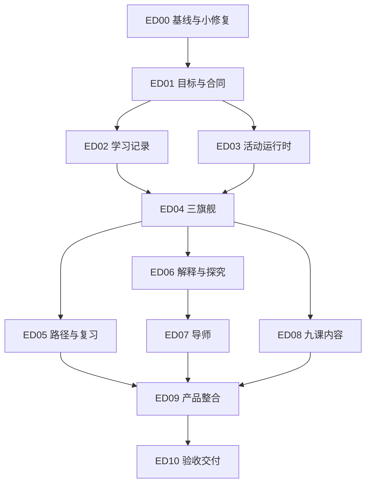

# ED00–ED10路线

## 8. 工程路线图：每个阶段交付一个学生能使用的增量

本轮使用 **ED00–ED10** 编号，避免与仓库已经完成的 UP00–UP11 混淆。已有工作不会因为新编号被自动重做。Codex 开始时重新核对 HEAD 和已实现范围，当前固定提交是审计锚点而不是强制回退版本。

### 8.1 工作包、依赖与成果

| 工作包 | 学生可见成果/工程目标 | 主要依赖 | 实施工作 | 预计工程人日 | 放行标准 |
|---|---|---|---|---:|---|
| ED00 基线与教学误导修复 | 合法数值询问得到核对；初始处理对照得到正确提示 | 当前主分支 | 验证当前差异、Skills、基线；修两项窄范围导师问题；维护教育升级进度 | 1–2 | 既有测试不退化；0现金、错单位、未来值、初始处理样例通过；明确未验证项 |
| ED01 目标、概念与题目蓝图 | 详情显示能做什么；三旗舰有目标—任务对齐预览 | ED00 | 12课三目标；规范概念ID/误解；新增兼容学习内容合同、作者校验器、题序审计 | 3–4 | 无悬空目标；三旗舰蓝图与真实规则相符；详情可浏览；不批量重写模型 |
| ED02 学习记录与证据 | 每次尝试、提示与独立表现可恢复 | ED01 | 追加尝试、暴露事件、本地事务、版本与旧数据迁移、派生状态 | 4–6 | 看答案后重答不变成新独立证据；旧笔记不丢；事务失败有恢复 |
| ED03 多活动课堂与补救 | 七阶段内可看例题、练一步、补救返回 | ED01，接ED02 | 兼容活动运行时、四类核心题型、现有证据选择复用、必要/可选任务、焦点/保存 | 5–7 | 拍卖一个闭环可运行；新增第八活动不再破坏旧课；不泄漏未来或私有信息 |
| ED04 三旗舰教学深化 | 拍卖、SVB、Schelling完整独立应用与解释 | ED02、ED03 | 复用手算/分类/九格，增加变式、针对性误解反馈、参考解与迁移 | 5–7 | 三课错误→帮助→新题→解释→迁移全部离线；学科机制与答案逐项核验 |
| ED05 路径、首页与复习 | 知道继续哪里、为什么复习、下一课是什么 | ED04 | 目标选择、先修短练、规则推荐、本地ReviewSchedule、概念与作品索引 | 4–6 | 六类首页状态；推荐有原因且可跳过；时区/跨天/内容升级正确 |
| ED06 解释与实验探究 | 参数台结果带回课内解释；跨课迁移 | ED04，ED02 | ExplanationCard、ExperimentCard、已核对SourceRef桥接、控制/处理说明、三组跨课挑战 | 4–6 | 引用有效与解释质量分开；预测不后填；多因素结果不假装单变量结论 |
| ED07 导师教学能力 | 针对本人回答的提示与追问 | ED04、ED06 | 内容化误解规则、结构化学习上下文、离线反馈、可选LLM草稿建议 | 4–6 | 无Key可完成；正确/错误草稿有针对性反馈边界；坏引用/超时有降级；不改学习证据判定 |
| ED08 其余九课与内容质量 | 十二课都拥有完整学习资源包 | ED04；使用ED05/06/07稳定合同 | 按课程族扩展九课；近迁移/条件辨异；来源/答案/语言审阅；质量校验工具 | 6–9 | 12/12离线闭环；各目标有任务；非复制题；数据身份与机制正确 |
| ED09 产品整合与教学展示 | 新导航、概念/收藏/展示/导出统一 | ED05–ED08 | 整合旧LabTools；移动端、键盘、减弱动画；设计规范与错误恢复；活动页 | 3–5 | 三端尺寸/键盘关键通路；旧链接保留；展示档案隔离且不回滚个人提示暴露 |
| ED10 综合验收与部署 | 可独立安装、学习、备份和恢复的完整版本 | ED00–ED09 | 内容审阅、机制/契约/E2E、迁移与备份、离线包、性能预算与交付文档 | 3–5 | 当前提交的收据齐全；未通过的Live或浏览器项明确保留；无虚假通过 |

**工期口径：** 合计 42–63 工程人日，含实施及基础内容接入，不包含独立经济学/教学内容审核的 6–10 人日。另建议为旧状态迁移、浏览器适配和内容修订预留约 25% 工程风险储备（约 11–16 人日）。这些是基于当前可复用资产的估算，不是 Codex 固定速度承诺。两名工程实施者加能及时响应的兼职经济学审阅，约 6–9 个工作周；单人顺序推进约 12–18 周。先完成垂直样板即可分批交付，无需等全部结束才看到产品。

ED08 的 6–9 人日依赖 ED01 已有完整蓝图、原机制无需重做、审阅并行及时。如果重新写模型或增加新课，应单列估算，不挤进现有范围。

### 8.2 并行策略与集成点

ED02 与 ED03 先共定事件合同再分工；ED05 与 ED06 可并行，ED08 的研究/撰写可提前、接线需等待共同合同稳定；ED09 设计走查可前置但最终验收在内容到位后进行。不要让多个代理同时重写 `flagship-lesson.tsx` 或共享 Schema；分配明确文件所有者，集成者负责兼容测试。建议每个合并请求围绕一条学生路径，避免一次改写全部十二课。

### 8.3 分批发布

- **M0：基线可信。** ED00 完成，已有产品仍可运行，两个具体误导已修。
- **M1：一课闭环。** ED01–ED03 接通拍卖最小学习过程，用户已能看到实际变化；不等完整课程生产。
- **M2：三个领域通用。** ED04 完成，三课证明合同适用于市场、银行和空间模型。
- **M3：连续自主学习。** ED05–ED07 完成，推荐、复习、实验与解释连起来；剩余九课保留原版可用路径。
- **M4：十二课完整升级。** ED08–ED10 完成，整体发布；在线真实供应商收据与离线正式教学分别标注状态。

### 8.4 风险与处理

| 风险 | 提前信号 | 处理方式 |
|---|---|---|
| 内容数量替代教学质量 | 每课看起来都有三目标但任务相同 | 每课抽一条独立解题与错误路径做人工学科审阅 |
| 新活动架构引发重写 | 同时替换所有领域面板 | 保留phase adapter，先一课，逐课接入 |
| 学习状态过度推断 | 看答案改对也显示已掌握 | 暴露记录先于显示；独立/重复/辅助判定可重放 |
| 旧数据丢失 | 迁移前删除旧key或覆盖版本 | 备份、事务、幂等、保留旧页可读、显式迁移表 |
| 默认私有信息被教学题提前揭示 | 例题直接引用未公开对手值 | 独立练习独立身份；源引用严格服从揭示范围 |
| LLM占据核心链路 | 提示离线不可用或无Key无法结课 | 作者反馈与规则优先；模型只作为可选建议 |
| 同一词误用到所有案例 | 将银行现金与订单深度当同一变量 | 概念页显式辨义；跨课迁移题必须包含不同条件 |
| 日程变成无意义打卡 | 以签到次数代替任务表现 | 可暂停复习，按具体证据推荐，不设强制连胜 |
| 工期低估内容审核 | 九课临近上线仍无答案解析 | ED01锁蓝图，审核工时单列，未审内容不进正式目录 |
