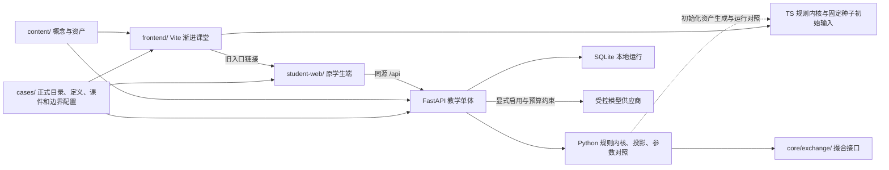
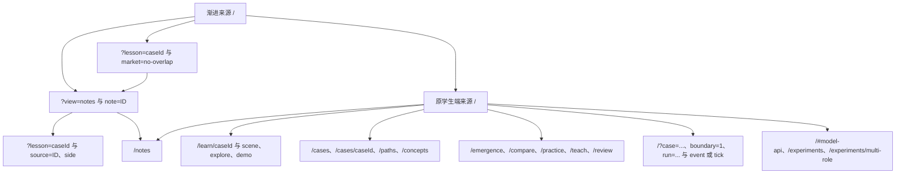
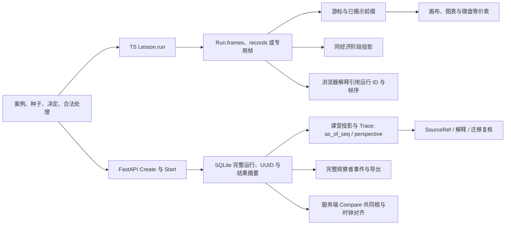
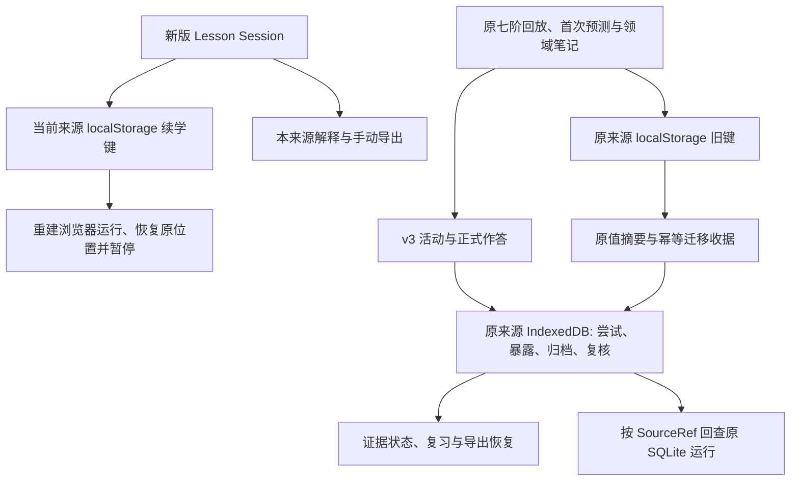
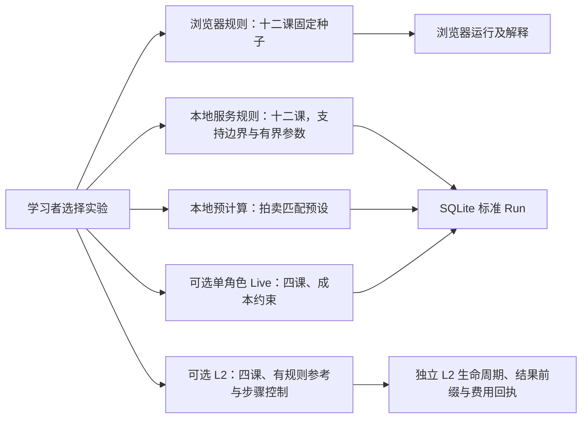

# EcoSimEdu V2 基线审计

审阅提交 `8fc89711edb6a43e79e8b808ffb245edfdfe127b`。十二门四阶课、十二门原七阶课及其学习服务均有可运行入口。V2 的首要工程任务是让两套入口正确解释已有记录的来源、版本和揭示范围。单标签页续学与原事件回查在本轮通过。双标签页复现了旧游标覆盖新进度，浏览器笔记复核也存在同 ID 内容变化无法识别的边界。后续处理见 [ADR](architecture-adr.md) 和 [验收矩阵](acceptance-matrix.md)。

## 模块依赖

核对范围包括 `frontend/` 67 个、`student-web/` 90 个、`services/simulation/` 37 个、`cases/` 58 个、`schemas/` 6 个及 `tests/` 68 个跟踪路径。模块入口以路由、内容目录、请求模型、服务端投影和现行测试为锚点。规则服务的撮合复用 `core/exchange/`，Streamlit 研究端有独立入口。[渐进入口](../../frontend/src/main.tsx#L1) · [旧端入口](../../student-web/src/main.tsx#L523) · [Python 案例登记](../../services/simulation/lessons.py#L8) · [撮合依赖](../../services/simulation/auction.py#L9)

## 页面路由

新版用查询参数切换视图，`studentOrigin` 默认指向 8877，构建时可指定来源。旧端根据路径和查询分派，同时由 FastAPI 显式登记深链，处理未知案例和非法旧查询。相同的 /、课堂、笔记、路径和部分概念在两个入口各自实现。新版笔记只在当前来源列出四阶解释，旧版同名页面处理 SQLite 运行引用与浏览器归档。学习入口与数据来源的关联见 [迁移表](reuse-and-migration-map.md)。[新版路由](../../frontend/src/classroom-routes.ts#L27) · [旧端分派](../../student-web/src/main.tsx#L558) · [深链服务](../../services/simulation/api.py#L948) · [新版笔记](../../frontend/src/StudentNotes.tsx#L8)

## 事件数据流

`lesson.ts` 的 `transition` 管理四阶解锁、原选择、回放和预测后比较。第三阶的图表与表格使用已揭示前缀。`Recorder.emit` 同时产生主记录、快照、事件贡献及子证据。服务端将规范化结果散列后保存，课堂投影与完整观察者读取是两条路径。聚合接口返回区间状态变化和来源，并以 `observed_transition` 标识口径。仿真计算、历史背景、模型恒等式、配对差异和解释假设各有来源。[状态定义](../../frontend/src/lesson.ts#L25) · [执行命令](../../frontend/src/lesson.ts#L147) · [记录器](../../frontend/src/models/record.ts#L47) · [SQLite 摘要](../../services/simulation/api.py#L131) · [Trace 契约](../../services/simulation/emergence/schemas.py#L53)

## 学习状态流

四阶会话依次进入场景决策、主体观察、宏微观联动与反事实。原端沿 `intro → predict → bid → observe → explain → compare → notebook` 管理七阶，v3 活动在阶段内运行。续学检查点、完成状态及独立证据各有身份。旧端的帮助暴露与作答走事务，归档恢复处理版本、重复 ID、冲突及缺失来源。新版按课和拍卖变体保存检查点，一般解释存为独立键。两边都遵从浏览器同源存储规则，端口变动会切换存储位置。[新版检查点](../../frontend/src/learning-store.ts#L3) · [旧端学习事务](../../student-web/src/learning/learner-repository.ts#L25) · [迁移](../../student-web/src/learning/migration.ts#L9) · [归档恢复](../../student-web/src/learning/learning-archive.ts#L228)

## 仿真执行模式

单角色与 L2 涉及 SVB、信息级联、公共品与 GameStop。L2 的 `rule_reference` 保持本机可用，模型凭据由服务端持有。完整运行摘要与 L2 前缀摘要各自对应不同记录。预计算受案例、种子、限价和预设组合约束。回放暂停和执行暂停使用不同接口。[预计算与创建校验](../../services/simulation/api.py#L176) · [规则执行](../../services/simulation/api.py#L562) · [单角色范围](../../services/simulation/live.py#L11) · [L2 状态与上限](../../services/simulation/live_l2.py#L14)

## 发现与最小处理策略

P1 表示迁移前需锁定的学习连续性或证据正确性。P2 表示可以随对应模块迁移的契约或维护成本。复现实验均由本轮测试档案和生成的运行组成。

| ID | 优先级与影响 | 证据与范围 | 最小处理 |
| --- | --- | --- | --- |
| B01 | P1 · 两个来源各自续学，换地址后原记录看起来消失 | 两个主页各自读进度，四阶笔记跨入口只提供原版链接。不同 origin 下的存储键不可直接读取。覆盖十二课、实验笔记和复习。[四阶首页](../../frontend/src/CourseMap.tsx#L8) · [旧端进度](../../student-web/src/learning/flagship-study.ts#L59) · [本地恢复约定](../../STUDENT_LAB.md#L17) | 先把主入口、原入口和来源写入发布配置。跨来源沿用原地址与显式归档，逐类增加可验证迁移。 |
| B02 | P1 · 原事件在内核升级后可能无法核对或误认为原版本 | 四阶笔记重算并比对字符串 ID 和帧存在性，ID 由种子、行动及场景构成。受控内存夹具保持 ID、改动事件指标后，原笔记仍能定位到改动后的指标。旧 Trace 读取会按当前案例和引擎版本返回 `TRACE_NOT_AVAILABLE`，原 Run 有独立读取入口。[浏览器 ID](../../frontend/src/models/record.ts#L89) · [笔记来源解析](../../frontend/src/learning-store.ts#L157) · [旧 Trace 兼容范围](../../services/simulation/api.py#L674) | 为新记录提供版本和结果摘要，保留旧号及格式。精确命中才称已核对，无法核对时保留文字及原始链接。旧版 Trace 按已有数据能力降级。 |
| B03 | P1 · 晚写的旧标签可以使续学倒退，失效记录无明确恢复提示 | Chromium 真跑双向拍卖，同档案标签 A 达事件 2，旧标签 B 到事件 1 后，首页恢复到事件 1。各标签按课直接写键。首页只查结构，重算失败后 Studio 打开新会话。[保存与恢复](../../frontend/src/learning-store.ts#L51) · [会话保存](../../frontend/src/Studio.tsx#L172) | 加入校验版本和冲突处理，主动回退与陈旧写入各有语义。校验失败保留原存档并显示明确恢复动作。 |
| B04 | P1 · SVB 四阶笔记中的「原事件」实际选择模型轮次 | SVB 每轮包含申请、支付、账表等子事件，返回普通 `Run`。实跑首个支付轮，帧内有 revaluation、request、payment，而导出索引的事件类型只有 round。其他十课有 `Recorder.records`，拍卖有独立订单事件。[SVB 帧](../../frontend/src/svb.ts#L31) · [记录归一](../../frontend/src/run-evidence.ts#L5) · [解释选择](../../frontend/src/Investigation.tsx#L7) | 用 SVB 已记录的子事件建立可查来源，保留旧轮次引用，并标明粒度。为子事件保留原 ID，别把轮次强转成服务端事件序号。 |
| B05 | P1 · 反事实的图表索引与原事件序号可以不同 | 浏览器学校匹配实跑对齐索引 0/1/2 对应原事件 0/2/11。通用投影将 tick 改成数组索引。旧端配对保留双方原 tick，并验证父子、种子、行动和共同根。[浏览器投影](../../frontend/src/models/course-lesson.ts#L48) · [对照表](../../frontend/src/Counterfactual.tsx#L73) · [服务端配对](../../services/simulation/projection.py#L48) | 保留已证实的经济时钟，用含对齐键、标签、原始 refs 和缺值的成对行表达。显示索引由视图计算。 |
| B06 | P1 · 统一证据视图需要维持现有已揭示上限和私有字段口径 | 新端图表、表格与区间切入一份可见帧，`locate` 校验上限。服务端 Trace 检查来源、焦点和上限，拍卖与级联另经过领域投影。原始导出属于完整复盘。本项为迁移约束。[浏览器 locate](../../frontend/src/lesson.ts#L193) · [可见图表](../../frontend/src/Studio.tsx#L285) · [服务端 Trace](../../services/simulation/api.py#L700) | 保持游标、已揭示范围、角色、观察者和时钟独立。所有跳转从同一可见投影取值，完整复盘保留明确入口。 |
| B07 | P2 · 十门通用课在不同位置维护正式身份、教学文案、图表指标与政策选择 | `defineCourse` 同时接收案例 JSON 和 TS 文案，四阶 `contentVersion` 来自案例 `version`。原 v3 从内容包独立读取版本。四阶比较使用 `metrics[0]`，第三阶可有独立主指标。信息级联的公开后验与公开选择比例在原端有独立 ID，前者已有浏览器内核。课程文案和资料变更需要跨入口核对。[课程构造](../../frontend/src/models/course-lesson.ts#L11) · [主指标与结果](../../frontend/src/lesson.ts#L129) · [级联课](../../frontend/src/models/information-lessons.ts#L41) · [旧投影](../../services/simulation/cooperation_view.py#L20) | 从现有目录、案例和课件组合版本清单。保留阶段各自的指标角色，明确单位和资料身份。按稳定 ID 关联正式学习包。 |
| B08 | P1 · 四阶解释缺少与正式独立作答、迁移和教师复核的连接 | 四阶保存四个结构字段和两次运行引用。正式尝试、暴露和教师往返在旧端，双来源教师工作流固定为 SVB 与闪电崩盘。[四阶解释保存](../../frontend/src/Investigation.tsx#L61) · [正式尝试](../../student-web/src/learning/learner-repository.ts#L128) · [双来源记录](../../student-web/src/learning/transfer-record.ts#L6) | 接回已有活动标识和评价器，先链接旧端任务。迁入时保留既有独立、辅助、重答与教师复核语义。 |
| B09 | P2 · 两套构建与启动配置造成旧链接失配 | `frontend` 用相对资产基址，默认旧端 8877。根 README 及旧端指南用 8776。旧端 esbuild 产物在 FastAPI 启动时挂载。静态四阶入口不自带本地服务。[Vite 设置](../../frontend/vite.config.ts#L1) · [esbuild](../../student-web/build.js#L15) · [服务端挂载](../../services/simulation/api.py#L948) | 记录实际启用的产品地址和兼容地址。部署合同验证双向深链、缺失构建提示以及已有浏览器来源。 |
| B10 | P2 · 同名类型与执行能力不同，调用方容易套用错误状态 | 两端各有 `Run`。旧拍卖类型的 Provider 为 rule/replay，在线和 L2 另有生命周期及版号。健康检查和模型配置受既有服务边界约束。[四阶 Run](../../frontend/src/lesson.ts#L49) · [原拍卖类型](../../student-web/src/contracts.ts#L1) · [模型设置](../../services/simulation/api.py#L301) · [L2 出口](../../services/simulation/live_l2.py#L413) | 网关按运行来源及模式显式派发。复用现有校验、投影、预算、错误及恢复语义。 |
| B11 | P2 · 图表输入与键盘证据视图间依赖调用方同步 | Canvas 为 `aria-hidden`，指针用类别轴索引回到原 tick。键盘由独立表格提供等价定位。Studio 会为图表创建新的前缀数组，`setOption` 随依赖重新执行。本轮没有性能退化实测。[图表](../../frontend/src/MetricChart.tsx#L38) · [键盘表格](../../frontend/src/Studio.tsx#L114) | 共用同一可见点模型和空值规则，保留可达焦点。先测高密度课及触摸输入，再决定是否缓存可见点。 |

[十二课覆盖与复用表](reuse-and-migration-map.md) · [逐项验收约束](acceptance-matrix.md) · [本次实测与复现步骤](executions/V2-00.md)
